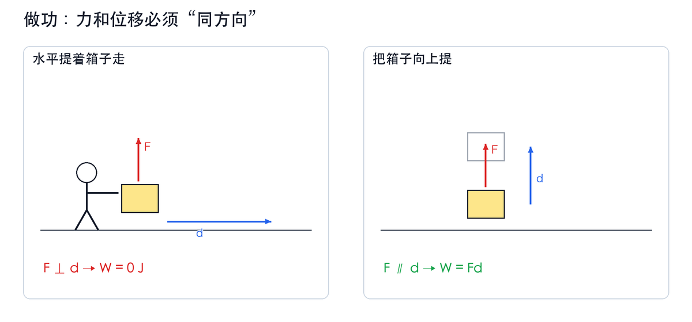

# IGCSE Physics 0625 – Topic 1: Motion, Forces and Energy（运动、力与能量）
- 这份笔记由 LG-leo 整理和维护。如果你觉得这份笔记对你有帮助，欢迎在 GitHub 上关注我或给我一个 ⭐，这能帮助我持续产出更多免费的学习资源。
- 我的其他课程笔记：https://github.com/LG-leo?tab=repositories
- This note is maintained by LG-leo. If you find it helpful, feel free to follow me or leave a ⭐ on GitHub. It helps me keep producing more free study resources. Check out my other notes: https://github.com/LG-leo?tab=repositories

## 重要说明

本文档依据 **CAIE 0625 Syllabus for 2026, 2027 and 2028**（version 2，2025 年 12 月发布）逐条整理，并参考 Paper 2 / Paper 4 常见考法补充答题关键词与易错点。

与仓库旧版相比，本版做了以下校正：

- **1.1 不考螺旋测微器、游标卡尺**：2026–2028 官方 1.1 只要求直尺、量筒、钟/数字计时器和单摆多次测量。
- **1.2 不要求运动方程**（`v = u + at`、`s = ut + ½at²`、`v² = u² + 2as` 不在现行考纲中）。
- **力矩属于 1.5.2 Core**，不是 Extended；只有“支点两侧多个力”的情况才是 Supplement。
- **1.6 动量整节都是 Supplement（Extended）**，Core 考生不考。
- **1.8 不考大气压、气压计、U 形管压力计**：现行 1.8 只要求 `P = F/A`、随力/面积变化、液体压强随深度/密度变化，以及 `Δp = ρgΔh`。
- **标量/矢量与两个垂直矢量的合成属于 1.1 Supplement**，旧版错误地放在 1.2。
- 补入旧版缺失：圆周运动定性、固体摩擦/液体与气体阻力、比例极限、`F = Δp/Δt`、静电势能、液体分层、效率的功率形式等。

参考来源：

- [CAIE 0625 Syllabus 2026–2028（官方 PDF）](https://www.cambridgeinternational.org/Images/697209-2026-2028-syllabus.pdf)
- [xtremepape.rs](https://papers.xtremepape.rs/) —— 历年真题索引
- [Save My Exams](https://www.savemyexams.com/igcse/physics/cie/23/) —— 按 topic 分类的试题与答案
- [IITian Academy](https://www.iitianacademy.com/igcse-physics/) —— 按 topic 分类的试题与解析

---

## Part 1: 考纲结构

| 编号 | 内容 | 中文 | 层级 |
|------|------|------|------|
| 1.1 | Physical quantities and measurement techniques | 物理量与测量技术 | Core + Supplement |
| 1.2 | Motion | 运动 | Core + Supplement |
| 1.3 | Mass and weight | 质量与重量 | Core + Supplement |
| 1.4 | Density | 密度 | Core + Supplement |
| 1.5 | Forces | 力的作用 | Core + Supplement |
| 1.5.1 | Effects of forces | 力的效果 | Core + Supplement |
| 1.5.2 | Turning effect of forces | 力矩 | Core + Supplement |
| 1.5.3 | Centre of gravity | 重心 | Core |
| 1.6 | Momentum | 动量 | **Supplement** |
| 1.7 | Energy, work and power | 能量、做功与功率 | Core + Supplement |
| 1.7.1 | Energy | 能量 | Core + Supplement |
| 1.7.2 | Work | 功 | Core |
| 1.7.3 | Energy resources | 能源资源 | Core + Supplement |
| 1.7.4 | Power | 功率 | Core |
| 1.8 | Pressure | 压力 | Core + Supplement |

> 记忆框架：**测量 → 运动 → 质量/重量 → 密度 → 力 → 动量 → 能量 → 压力**。

---

## Part 2: 考点整理

### 1.1 物理量与测量技术（Core + Supplement）

**Core**
- 用**直尺（ruler）**和**量筒（measuring cylinder）**测量长度或体积。
  - 量筒读数：视线与**凹液面最低处**平齐。
- 用**钟或数字计时器（clocks / digital timers）**测量各种时间间隔。
- 通过**多次测量**求小距离/短时间的平均值，包括**单摆的振动周期**：
  - 测 n 次全振动的总时间 t，周期 `T = t/n`。

**Supplement**
- **标量（scalar）**：只有大小；**矢量（vector）**：既有大小又有方向。
- 标量：**distance、speed、time、mass、energy、temperature**。
- 矢量：**force、weight、velocity、acceleration、momentum、electric field strength、gravitational field strength**。
- 求**两个互相垂直的矢量**的合力：可用计算或作图，**只限力或速度**（官方 1.1 Supplement 7，仅 Extended）。
  - 大小：`R = √(F₁² + F₂²)`；
  - 方向：`tan θ = F₂ / F₁`（相对 F₁）。
  - **真题例（0625/42 Feb/March 2023 Q1）**：船横渡速度 3.5 m/s，水流 2.5 m/s 与之垂直；`R = √(3.5² + 2.5²) ≈ 4.3 m/s`，`tan θ = 3.5/2.5` → θ ≈ 54°（相对河岸）。

**易错点**
- 2026–2028 **不考**螺旋测微器、游标卡尺，也不要求记 0.01 mm/0.1 mm 精度。
- temperature 是**标量**；weight、electric field strength、gravitational field strength 是**矢量**。
- 平均速度用**总距离 ÷ 总时间**，不是“把几个速度平均”。
- 单摆要数**完整振动**次数，别把半个来回算一次。

---

### 1.2 运动（Core + Supplement）

**Core**
- **速率（speed）**：单位时间走过的距离，`v = s / t`。
- **速度（velocity）**：速率加上方向（speed in a given direction）。
- **平均速率**：`average speed = total distance travelled / total time taken`。
- 会画、会解释**距离–时间图（d–t）**和**速度–时间图（v–t）**：
  - d–t 图：水平线 → 静止；直线 → 匀速；曲线 → 加速/减速；
  - v–t 图：水平线 → 匀速；直线 → 匀加速/匀减速；曲线 → 变加速。
- 从 d–t 图**直线的斜率**求速率。
- 从 v–t 图**曲线下面积**求距离（限匀速或匀加速的运动）。
- 近地表**自由落体**的加速度 `g` 近似恒定，约 **9.8 m/s²**。

**Supplement**
- **加速度**：速度的变化率，`a = Δv / Δt`。
- 从数据或 v–t 图形状判断：**匀加速**还是**变加速**。
- 从 v–t 图**斜率**求加速度。
- **减速（deceleration）**是负加速度，可用于计算。
- 描述物体在重力场中下落（有/无空气或液体阻力）的运动，包括**终端速度（terminal velocity）**：
  - 重力 > 阻力 → 加速；阻力随速度增大；
  - 重力 = 阻力 → 合力为零 → 匀速下落（终端速度）。

**易错点**
- **距离 vs 位移**：距离是标量（总路程）；位移是矢量（起点到终点的直线距离 + 方向）。
- **速率 vs 速度**：匀速圆周运动速率不变，但速度方向在变，所以速度在变。
- d–t 图斜率是速率；v–t 图斜率是加速度、面积是**距离**。
- 0625 **不要求** `v = u + at`、`s = ut + ½at²`、`v² = u² + 2as`；不要在这上面花时间。
- 终端速度时**合力为零、速度恒定**，不是“加速度最大”。
- 减速的本质是**加速度与速度方向相反**，不一定写成“负加速度”才得分。

---

### 1.3 质量与重量（Core + Supplement）

**Core**
- **质量（mass）**：物体中物质的多少（相对观察者静止时）；单位 kg。
- **重量（weight）**：作用在有质量物体上的**重力**；单位 N，方向竖直向下。
- **重力场强度**：`g = W / m`，单位 **N/kg**；它等于**自由落体加速度**（m/s²）。
- 天平（balances）可用来比较质量/重量。

**Supplement**
- 把重量理解为**重力场对质量的作用效果**。

**易错点**
- 质量是**标量**，不随位置变；重量是**矢量**，随 g 变。
- `g = 9.8 N/kg = 9.8 m/s²`，两个单位等价。
- 天平测质量；弹簧测力计测重量。

---

### 1.4 密度（Core + Supplement）

**Core**
- **密度**：单位体积的质量，`ρ = m / V`；单位 kg/m³ 或 g/cm³。
- 测定密度：
  - **液体**：天平测质量，量筒测体积；
  - **规则固体**：天平测质量，直尺量尺寸算体积；
  - **会沉入液体的不规则固体**：天平测质量，**排水法**测体积。
- 根据密度数据判断物体是否**漂浮**：
  - `ρ_object < ρ_fluid` → 漂浮；
  - `ρ_object = ρ_fluid` → 悬浮；
  - `ρ_object > ρ_fluid` → 下沉。

**Supplement**
- 根据密度判断**一种液体是否会浮在另一种不混合液体上**。

**易错点**
- `1 g/cm³ = 1000 kg/m³`。
- 排水法适用于**会沉下去**的不规则固体；漂浮物不能直接用排水法。
- 比较密度要同时看质量和体积。
- 液体分层：密度小的在上层。

---

### 1.5 力的作用（Core + Supplement）

#### 1.5.1 力的效果（Core + Supplement）

**Core**
- 力可能使物体**大小/形状**改变。
- 会画、会解释**弹性固体的载荷–伸长（load–extension）图**，并描述实验步骤。
- 求**同一直线上**两个或多个力的合力。
- **牛顿第一定律**：没有合力时，物体保持静止或匀速直线运动。
- 合力可以改变物体的**速度方向**或**速度大小**。
- **固体摩擦**：阻碍运动并产生热。
- **阻力（drag）**：物体在液体或气体（如空气阻力）中运动时受到的阻力。

**Supplement**
- **弹簧常数**：`k = F / x`，单位 N/m。
- **比例极限（limit of proportionality）**：载荷–伸长图仍为直线的最大点；会识别该点。
  - 考纲明确：**不要求 elastic limit**。
- **牛顿第二定律**：`F = m a`，F 与 a 同方向。
- **圆周运动定性**：
  - 质量、半径不变时，力越大 → 速度越大；
  - 质量、速度不变时，力越大 → 半径越小；
  - 速度、半径不变时，质量越大 → 所需力越大；
  - `F = mv²/r` **不要求**。

**易错点**
- 胡克定律用**伸长量 x**（现长 − 原长），不是总长度。
- 比例极限 ≠ 弹性极限；考纲只要求比例极限，**elastic limit 不考**。
- `F = ma` 中的 F 是**合力**，先求合力再代入。
- 摩擦力/阻力方向与**相对运动方向相反**。
- 圆周运动的力**指向圆心**，与运动方向垂直。

#### 1.5.2 力矩（Core + Supplement）

**Core**
- **力矩**是力使物体绕支点转动效果的量度；`moment = force × perpendicular distance from pivot`。
- **力矩原理**：支点两侧各有一个力时，顺时针力矩 = 逆时针力矩（可处理横梁平衡）。
- **平衡（equilibrium）**：没有合力，也没有合力矩。

**Supplement**
- 力矩原理用于**支点两侧有多个力**的情况。
- 描述实验证明：平衡时物体**没有合力矩**。

**易错点**
- `d` 是到支点的**垂直距离**，不是沿力的方向的距离。
- 力矩单位 N·m，不是 J。
- 平衡必须同时满足：**合力为零 + 合力矩为零**。

#### 1.5.3 重心（Core）

- **重心**：物体重力作用的点。
- 实验：用**铅垂线**确定不规则薄板的重心。
- **稳定性**：重心越低、底面积越大，物体越稳定。

**易错点**
- 均匀规则物体的重心在**几何中心**。
- 重心可以不在物体上（如圆环）。

---

### 1.6 动量（Supplement only）

> 整节 1.6 都是 Supplement；Core 考生不考。

- **动量**：`p = m v`，单位 kg·m/s，矢量（方向与速度相同）。
- **冲量**：`impulse = F Δt = Δp = m v − m u`。
- **动量守恒**：封闭系统（无外力/合外力为零）中，碰撞前总动量 = 碰撞后总动量；用于一维问题。
- **合力 = 动量变化率**：`F = Δp / Δt`。

**易错点**
- 动量是矢量，一维问题先规定正方向，反向速度带负号。
- 动量守恒条件要写明“系统不受外力/合外力为零”。
- 爆炸、反冲也适用动量守恒，但动能不一定守恒。
- 冲量是力 × 时间，不是力 × 距离。

---

### 1.7 能量、做功与功率

#### 1.7.1 能量（Core + Supplement）

**Core**
- 能量可以储存在：**动能、重力势能、化学能、弹性形变能、核能、静电势能、内能（thermal）**。
- 能量可以在储存之间转移，例如通过：
  - **力/机械做功**；
  - **电流/电做功**；
  - **加热**；
  - **电磁波、声波等波**。
- **能量守恒**：能量不能被创造或消灭，只能转移或转化；能用简单流程图表示。

**Supplement**
- `KE = ½ m v²`。
- 重力势能变化：`ΔGPE = m g Δh`。
- 用能量守恒分析**多阶段复杂过程**，包括 **Sankey 图**。

**易错点**
- 区分**能量储存**和**能量转移**：不能说“能量是力”。
- 能量不是“用掉了”，而是转化/转移到环境。
- 速度加倍 → 动能变 **4 倍**。
- GPE 用**高度变化 Δh**，不是绝对高度。

#### 1.7.2 功（Core）

- 机械功或电功 = 转移的能量。
- `W = F d = ΔE`（d 是沿力方向的位移）。

**易错点**
- 力与位移垂直时**不做功**（如水平提箱走）。
- 功的单位 J，不是 N 或 W。
- 做功可以增加物体内能（摩擦生热）。

#### 1.7.3 能源资源（Core + Supplement）

**Core**
- 描述如何从以下资源获得有用能量/发电：
  - **化石燃料**（化学能）；
  - **生物燃料**（化学能）；
  - **水**：波浪、潮汐、水坝水力；
  - **地热**；
  - **核燃料**；
  - **太阳光 → 太阳能电池（solar cells）**；
  - **太阳的红外/其他电磁波 → 太阳能热水器（solar panels）**；
  - **风能**（最终来自太阳）；
  - 需要时说明锅炉、涡轮机、发电机的作用。
- 从**可再生性、可用性、可靠性、规模、环境影响**比较各能源的优缺点。
- 定性理解**效率**。

**Supplement**
- 除**地热、核能、潮汐**外，所有能源最终来自**太阳辐射**。
- 太阳的能量来自**核聚变**。
- 正在研究如何把聚变能量大规模用于发电。
- **效率**：
  - `% efficiency = useful energy output / total energy input × 100%`；
  - `% efficiency = useful power output / total power input × 100%`。

**易错点**
- **太阳能电池（solar cells）**直接发电；**太阳能热水器（solar panels）**加热水，别混。
- 可再生能源 ≠ 始终可靠（风、太阳是间歇性的）。
- 效率永远小于 100%；“浪费”的能量通常变成内能。
- 核能、地热、潮汐**不是**来自太阳（按考纲表述）。

#### 1.7.4 功率（Core）

- **功率**：单位时间做的功，或单位时间转移的能量。
- `P = W / t = E / t`，单位 W（J/s）。

**易错点**
- 功率大 = 能量转移快，不是“做功多”（还要看时间）。
- 1 W = 1 J/s。

---

### 1.8 压力（Core + Supplement）

**Core**
- **压力（压强）**：单位面积上的力，`P = F / A`，单位 Pa（N/m²）。
- 压力随**力**增大而增大，随**面积**增大而减小；结合刀刃、图钉等例子说明。
- 定性描述液体内部压力随**深度**和**液体密度**的变化。

**Supplement**
- 液体表面下压力变化：`Δp = ρ g Δh`。

**易错点**
- 压力不是重力；`P = F/A` 中 F 是**垂直作用在面积上的力**。
- 液体压力与容器形状、液体总量无关，只看深度和密度。
- 用 `Δp = ρgΔh` 时 h 是**深度差**。
- 2026–2028 的 1.8 **不考**大气压、气压计、U 形管压力计。

---

## Part 2.5: 直观理解（帮助记忆，不考）

- **距离 vs 位移**：距离是“走路的总步数”，位移是“从起点到终点的直线箭头”。绕操场跑一圈：距离 400 m，位移 0。
- **速率 vs 速度**：速率只看“跑多快”，速度还要看“往哪跑”。匀速圆周运动速率不变，但方向在变，所以速度在变。
- **d–t 图 vs v–t 图**：d–t 图的斜率是速度；v–t 图的斜率是加速度、面积是距离。先看坐标轴，再决定用“斜率”还是“面积”。
- **加速度方向 ≠ 运动方向**：刹车时速度向前、加速度向后；减速的本质是“加速度与速度反向”，不是“加速度为负”。
- **自由落体与终端速度**：重力向下拉、空气阻力向上顶；速度越大阻力越大，二者相等时合力为零 → 匀速下落。
- **质量 vs 重量**：质量是“有多少东西”（kg），重量是“被地球拉多用力”（N）；到月球质量不变、重量变小。
- **密度**：单位体积里“塞了多少质量”；排水法就是“看物体挤走了多少水”。
- **合力与 F=ma**：F 是“所有力抵消后剩下的合力”；先求合力，再求加速度。
- **力矩**：扳手越长越省力，因为力矩 = 力 × 到支点的垂直距离；斜着拉要用垂距。
- **功与功率**：功是“干了多少活”（J），功率是“干活多快”（J/s）；提着箱子水平走，不做功。
- **能量守恒**：能量不会消失，只会“换马甲”；答题要写清“从什么能变成什么能”。
- **压强**：同样的力，面积越小压强越大（刀锋、图钉）；液体压强只看深度和密度，与容器形状无关。

> 图：水平提箱时力与位移垂直（W=0）；向上提时力与位移同向（W=Fd）。

---

## Part 3: 必背公式与常量

| 名称 | 公式 | 单位 | 层级/条件 |
|---|---|---|---|
| 速率 | `v = s / t` | m/s | Core |
| 平均速率 | `average speed = total distance / total time` | m/s | Core |
| 加速度 | `a = Δv / Δt` | m/s² | Supplement |
| 自由落体加速度 | `g ≈ 9.8 m/s²` | m/s² | Core |
| 重量 | `W = m g`；`g = W/m` | N、N/kg | Core |
| 密度 | `ρ = m / V` | kg/m³ | Core |
| 弹簧常数 | `k = F / x` | N/m | Supplement |
| 牛顿第二定律 | `F = m a` | N | Supplement |
| 力矩 | `moment = F × d⊥` | N·m | Core |
| 动量 | `p = m v` | kg·m/s | Supplement |
| 冲量 | `F Δt = Δp = m v − m u` | N·s | Supplement |
| 合力与动量 | `F = Δp / Δt` | N | Supplement |
| 动能 | `KE = ½ m v²` | J | Supplement |
| 重力势能变化 | `ΔGPE = m g Δh` | J | Supplement |
| 功 | `W = F d = ΔE` | J | Core |
| 功率 | `P = W / t = E / t` | W | Core |
| 效率 | `useful output / total input × 100%` | % | Supplement |
| 压力 | `P = F / A` | Pa | Core |
| 液体压力变化 | `Δp = ρ g Δh` | Pa | Supplement |
| 两个垂直矢量合力 | `R = √(F₁² + F₂²)` | — | Supplement（限力/速度） |

---

## Part 4: 高频易错点速查

| 错误说法 | 正确理解 |
|---|---|
| 用螺旋测微器测铜丝直径是 0625 考点 | 0625 2026–2028 **不考** micrometer/vernier |
| 速度-时间图面积 = 位移 | 面积 = **距离**（speed-time 图不含方向） |
| 距离-时间图水平线 = 匀速 | 水平线 = **静止** |
| 匀速圆周运动速度不变 | 速率不变，**速度方向变** → 速度变 |
| 月球上质量变小 | 质量不变，**重量**变小 |
| 1 g/cm³ = 100 kg/m³ | = **1000 kg/m³** |
| 弹簧长度与力成正比 | **伸长量**与力成正比 |
| 力矩 = 力 × 支点到力的距离 | 力 × 到力作用线的**垂直距离** |
| 力矩是 Extended | 力矩是 **1.5.2 Core**；多力平衡才是 Supplement |
| F=ma 中的 F 是拉力 | F 是**合力** |
| 终端速度时加速度最大 | 加速度为 **0**，速度最大且恒定 |
| 动量守恒不用管方向 | 矢量，先**规定正方向** |
| 效率可以到 100% | 永远小于 100% |
| 液体越深压强越大是因为水多 | 只因为 **深度 h 大**（与总量无关） |
| 大气压是 1.8 考点 | 现行 1.8 **不考**大气压/气压计/压力计 |

---

## Part 5: Paper 4 答题模板

- **平均速率**：Average speed is the total distance travelled divided by the total time taken.
- **速度 vs 速率**：Velocity is speed in a given direction; speed is a scalar.
- **d–t 图**：The gradient of a distance–time graph gives the speed; a horizontal line means the object is at rest.
- **v–t 图**：The gradient of a speed–time graph gives the acceleration; the area under the graph gives the distance travelled.
- **终端速度**：Initially weight is greater than air resistance, so the object accelerates. As speed increases, air resistance increases until it equals the weight; the resultant force is then zero, so the object falls at a constant terminal velocity.
- **牛顿第二定律**：The resultant force on an object is directly proportional to its acceleration and acts in the same direction: `F = ma`.
- **胡克定律/比例极限**：The extension is directly proportional to the load, provided the limit of proportionality is not exceeded.
- **力矩**：The moment of a force is the force multiplied by the perpendicular distance from the pivot. In equilibrium, the sum of clockwise moments equals the sum of anticlockwise moments.
- **动量守恒**：In a closed system with no external resultant force, the total momentum before a collision equals the total momentum after it.
- **能量守恒**：Energy cannot be created or destroyed, only transferred between stores; state the stores involved explicitly.
- **效率**：Efficiency = useful energy output ÷ total energy input × 100% (or the power version).
- **液体压力**：The change in pressure beneath a liquid surface is `Δp = ρgΔh`, where h is the change in depth.

---

## Part 6: 关键词词汇表

| 关键词 | 定义 |
|---|---|
| **Scalar**（标量） | 只有大小、没有方向 |
| **Vector**（矢量） | 既有大小又有方向 |
| **Speed**（速率） | 单位时间的距离 |
| **Velocity**（速度） | 速率 + 方向 |
| **Average speed**（平均速率） | 总距离 ÷ 总时间 |
| **Acceleration**（加速度） | 速度的变化率，`a = Δv/Δt` |
| **Deceleration**（减速） | 负加速度（与速度反向） |
| **Terminal velocity**（终端速度） | 合力为零时的最大恒定速度 |
| **Mass**（质量） | 物质的多少，kg，标量 |
| **Weight**（重量） | 重力，N，矢量 |
| **Gravitational field strength**（重力场强度） | `g = W/m`，N/kg，等于自由落体加速度 |
| **Density**（密度） | `ρ = m/V` |
| **Resultant force**（合力） | 所有力的矢量和 |
| **Friction / drag**（摩擦/阻力） | 阻碍相对运动的力 |
| **Spring constant**（弹簧常数） | `k = F/x` |
| **Limit of proportionality**（比例极限） | 载荷–伸长图仍为直线的最大点 |
| **Moment**（力矩） | `F × 垂直距离`，N·m |
| **Centre of gravity**（重心） | 重力作用的点 |
| **Momentum**（动量） | `p = mv`，矢量 |
| **Impulse**（冲量） | `FΔt = Δp` |
| **Conservation of momentum**（动量守恒） | 封闭系统总动量不变 |
| **Kinetic energy**（动能） | `KE = ½mv²` |
| **Gravitational potential energy**（重力势能） | `ΔGPE = mgΔh` |
| **Work done**（功） | `W = Fd = ΔE` |
| **Power**（功率） | `P = W/t = E/t` |
| **Efficiency**（效率） | 有用输出/总输入 × 100% |
| **Pressure**（压力/压强） | `P = F/A` |
| **Liquid pressure**（液体压力） | `Δp = ρgΔh` |

---

## Part 7: 考前自检

1. 直尺/量筒/计时器怎么用？单摆周期怎么测？
2. 标量/矢量分别有哪些？两个垂直矢量怎么合成？
3. 速率、速度、平均速度、加速度的定义与公式？
4. d–t 图和 v–t 图的斜率/面积分别代表什么？
5. 自由落体与终端速度的完整过程？
6. 质量与重量的区别？`g = W/m` 与 9.8 m/s² 的关系？
7. 密度怎么测（液体/规则固体/不规则固体）？沉浮条件？
8. 力的效果、合力、牛顿第一/第二定律？
9. 胡克定律、比例极限、弹簧常数？
10. 力矩与力矩原理？平衡条件？重心与稳定性？
11. 动量、冲量、动量守恒、`F = Δp/Δt`？
12. 能量储存/转移、KE/GPE、功、功率、效率？
13. 各种能源的优缺点？为什么太阳是大多数能源的最终来源？
14. `P = F/A` 与 `Δp = ρgΔh` 的应用？
