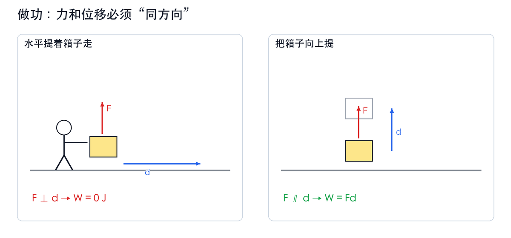

# IGCSE Physics 0625 – Topic 1: Motion, Forces and Energy
- 这份笔记由 LG-leo 整理和维护。如果你觉得这份笔记对你有帮助，欢迎在 GitHub 上关注我或给我一个 ⭐，这能帮助我持续产出更多免费的学习资源。
- 我的其他课程笔记：https://github.com/LG-leo?tab=repositories
- This note is maintained by LG-leo. If you find it helpful, feel free to follow me or leave a ⭐ on GitHub. It helps me keep producing more free study resources. Check out my other notes: https://github.com/LG-leo?tab=repositories

## Important Notes

This document follows the **CAIE 0625 Syllabus for 2026, 2027 and 2028** (version 2, published December 2025) point by point, and adds exam keywords and common traps based on Paper 2 and Paper 4 questions.

Corrections compared with the older version of this note:

- **No micrometer screw gauge or vernier caliper in 1.1**: the current syllabus requires only rulers, measuring cylinders, clocks/digital timers and multiples for a pendulum.
- **No equations of motion** (`v = u + at`, `s = ut + ½at²`, `v² = u² + 2as`) in 1.2.
- **Moments are Core (1.5.2)**, not Extended; only "more than one force each side" is Supplement.
- **The whole of 1.6 Momentum is Supplement**; Core candidates do not study it.
- **No atmospheric pressure, barometer or manometer in 1.8**; only `P = F/A`, variation with force/area, qualitative liquid pressure and `Δp = ρgΔh`.
- **Scalars, vectors and the resultant of two perpendicular vectors are in 1.1 Supplement**, not 1.2.
- Added missing content: qualitative circular motion, solid friction/drag, limit of proportionality, `F = Δp/Δt`, electrostatic energy, liquid layers, and the power form of efficiency.

Sources:

- [CAIE 0625 Syllabus 2026–2028 (official PDF)](https://www.cambridgeinternational.org/Images/697209-2026-2028-syllabus.pdf)
- [xtremepape.rs](https://papers.xtremepape.rs/) – past paper index
- [Save My Exams](https://www.savemyexams.com/igcse/physics/cie/23/) – topic-wise questions and answers
- [IITian Academy](https://www.iitianacademy.com/igcse-physics/) – topic-wise questions

---

## Part 1: Syllabus Structure

| No. | Content | Chinese | Tier |
|-----|---------|---------|------|
| 1.1 | Physical quantities and measurement techniques | 物理量与测量技术 | Core + Supplement |
| 1.2 | Motion | 运动 | Core + Supplement |
| 1.3 | Mass and weight | 质量与重量 | Core + Supplement |
| 1.4 | Density | 密度 | Core + Supplement |
| 1.5 | Forces | 力的作用 | Core + Supplement |
| 1.5.1 | Effects of forces | 力的效果 | Core + Supplement |
| 1.5.2 | Turning effect of forces | 力矩 | Core + Supplement |
| 1.5.3 | Centre of gravity | 重心 | Core |
| 1.6 | Momentum | 动量 | **Supplement** |
| 1.7 | Energy, work and power | 能量、做功与功率 | Core + Supplement |
| 1.7.1 | Energy | 能量 | Core + Supplement |
| 1.7.2 | Work | 功 | Core |
| 1.7.3 | Energy resources | 能源资源 | Core + Supplement |
| 1.7.4 | Power | 功率 | Core |
| 1.8 | Pressure | 压力 | Core + Supplement |

> Memory hook: **measurement → motion → mass/weight → density → forces → momentum → energy → pressure**.

---

## Part 2: Knowledge Points

### 1.1 Physical Quantities and Measurement Techniques (Core + Supplement)

**Core**
- Use **rulers** and **measuring cylinders** to find a length or volume.
  - Read a measuring cylinder with the eye level with the **bottom of the meniscus**.
- Use **clocks and digital timers** to measure a variety of time intervals.
- Determine an average value for a small distance or short interval by **measuring multiples**, including the **period of a pendulum**:
  - measure the total time t for n complete oscillations; `T = t/n`.

**Supplement**
- **Scalars** have magnitude only; **vectors** have magnitude and direction.
- Scalars: **distance, speed, time, mass, energy, temperature**.
- Vectors: **force, weight, velocity, acceleration, momentum, electric field strength, gravitational field strength**.
- Determine the **resultant of two vectors at right angles**, by calculation or graphically, **limited to forces or velocities only** (syllabus 1.1 Supplement 7; Extended only):
  - magnitude: `R = √(F₁² + F₂²)`;
  - direction: `tan θ = F₂ / F₁` (relative to F₁);
  - **Past-paper example (0625/42 Feb/March 2023 Q1)**: a boat crosses at 3.5 m/s while a current of 2.5 m/s flows at right angles; `R = √(3.5² + 2.5²) ≈ 4.3 m/s`, and `tan θ = 3.5/2.5` → θ ≈ 54° to the bank.

**Common traps**
- Micrometer screw gauge and vernier caliper are **not part of 0625 2026–2028**; do not memorise their names or precisions.
- Temperature is a **scalar**; weight, electric field strength and gravitational field strength are **vectors**.
- Average speed = **total distance ÷ total time**, not the average of several speeds.
- Count **complete oscillations** for a pendulum, not a half-swing.

---

### 1.2 Motion (Core + Supplement)

**Core**
- **Speed**: distance travelled per unit time, `v = s / t`.
- **Velocity**: speed in a given direction.
- **Average speed**: `average speed = total distance travelled / total time taken`.
- Sketch, plot and interpret **distance–time** and **speed–time** graphs:
  - distance–time: horizontal line → at rest; straight line → constant speed; curve → accelerating/decelerating;
  - speed–time: horizontal line → constant speed; straight line → constant acceleration/deceleration; curve → changing acceleration.
- Calculate speed from the **gradient** of a straight section of a distance–time graph.
- Calculate distance from the **area under** a speed–time graph (for constant speed or constant acceleration).
- The acceleration of free fall `g` near the Earth's surface is approximately constant, about **9.8 m/s²**.

**Supplement**
- **Acceleration**: rate of change of velocity, `a = Δv / Δt`.
- Determine from data or the shape of a speed–time graph whether acceleration is **constant** or **changing**.
- Calculate acceleration from the **gradient** of a speed–time graph.
- **Deceleration** is negative acceleration; use it in calculations.
- Describe motion in a gravitational field **with and without air/liquid resistance**, including **terminal velocity**:
  - weight > drag → acceleration; drag increases with speed;
  - weight = drag → resultant force zero → constant velocity (terminal velocity).

**Common traps**
- **Distance vs displacement**: distance is a scalar; displacement is a vector (straight line from start to finish, with direction).
- **Speed vs velocity**: in uniform circular motion the speed is constant but the direction changes, so the velocity changes.
- Gradient of distance–time = speed; gradient of speed–time = acceleration; area under speed–time = **distance**.
- 0625 does **not** require `v = u + at`, `s = ut + ½at²` or `v² = u² + 2as`.
- At terminal velocity the **resultant force is zero** and the velocity is constant, not the acceleration maximum.
- Deceleration means acceleration opposite to velocity; you do not have to write "negative acceleration".

---

### 1.3 Mass and Weight (Core + Supplement)

**Core**
- **Mass**: the quantity of matter in an object at rest relative to the observer; unit kg.
- **Weight**: the gravitational force acting on an object with mass; unit N, directed vertically downwards.
- **Gravitational field strength**: `g = W / m`, unit **N/kg**; it is equivalent to the **acceleration of free fall** (m/s²).
- Balances can be used to compare masses/weights.

**Supplement**
- Understand weight as the **effect of a gravitational field on a mass**.

**Common traps**
- Mass is a **scalar** and does not change with position; weight is a **vector** and changes with g.
- `g = 9.8 N/kg = 9.8 m/s²`; the two units are equivalent.
- A balance measures mass; a spring balance measures weight.

---

### 1.4 Density (Core + Supplement)

**Core**
- **Density**: mass per unit volume, `ρ = m / V`; units kg/m³ or g/cm³.
- Determine density:
  - **liquid**: mass with a balance, volume with a measuring cylinder;
  - **regular solid**: mass with a balance, dimensions with a ruler;
  - **irregular solid that sinks**: mass with a balance, volume by **displacement**.
- Use density data to determine whether an object **floats**:
  - `ρ_object < ρ_fluid` → floats;
  - `ρ_object = ρ_fluid` → suspended;
  - `ρ_object > ρ_fluid` → sinks.

**Supplement**
- Use density data to determine whether **one liquid floats on another** (liquids that do not mix).

**Common traps**
- `1 g/cm³ = 1000 kg/m³`.
- Displacement works for an irregular solid that **sinks**; a floating object cannot be measured directly this way.
- Compare density using both mass and volume.
- For immiscible liquids, the less dense liquid forms the upper layer.

---

### 1.5 Forces (Core + Supplement)

#### 1.5.1 Effects of Forces (Core + Supplement)

**Core**
- Forces may produce changes in the **size and shape** of an object.
- Sketch, plot and interpret **load–extension graphs** for an elastic solid; describe the experimental procedure.
- Determine the **resultant** of two or more forces acting along the same straight line.
- **Newton's first law**: an object remains at rest or continues at constant speed in a straight line unless acted on by a resultant force.
- A resultant force may change an object's **speed** or **direction of motion**.
- **Solid friction**: the force between surfaces that may impede motion and produce heating.
- **Drag**: friction on an object moving through a liquid or a gas (e.g. air resistance).

**Supplement**
- **Spring constant**: `k = F / x`, unit N/m.
- **Limit of proportionality**: the point beyond which the load–extension graph is no longer a straight line; identify it on a graph.
  - The syllabus states that **elastic limit is not required**.
- **Newton's second law**: `F = m a`, with force and acceleration in the same direction.
- **Circular motion (qualitative)**:
  - for constant mass and radius, a larger force gives a larger speed;
  - for constant mass and speed, a larger force gives a smaller radius;
  - for constant speed and radius, a larger mass requires a larger force;
  - `F = mv²/r` is **not required**.

**Common traps**
- Hooke's law uses the **extension x** (current length − original length), not the total length.
- Limit of proportionality is not the elastic limit; **elastic limit is not examined**.
- In `F = ma`, F is the **resultant** force; find the resultant first.
- Friction/drag acts opposite to the **relative motion**.
- For circular motion the force is **towards the centre**, perpendicular to the motion.

#### 1.5.2 Turning Effect of Forces (Core + Supplement)

**Core**
- The **moment** of a force is a measure of its turning effect; `moment = force × perpendicular distance from the pivot`.
- **Principle of moments**: with one force on each side of the pivot, the sum of clockwise moments equals the sum of anticlockwise moments (e.g. a balanced beam).
- **Equilibrium**: no resultant force and no resultant moment.

**Supplement**
- Apply the principle of moments with **more than one force on each side** of the pivot.
- Describe an experiment demonstrating that there is **no resultant moment** on an object in equilibrium.

**Common traps**
- `d` is the **perpendicular** distance from the pivot to the line of action of the force.
- The unit of moment is N·m, not J.
- Equilibrium requires **both** zero resultant force and zero resultant moment.

#### 1.5.3 Centre of Gravity (Core)

- **Centre of gravity**: the point through which the weight of an object acts.
- Experiment: use a **plumb line** to find the centre of gravity of an irregular plane lamina.
- **Stability**: a lower centre of gravity and a wider base make an object more stable.

**Common traps**
- For a uniform regular object, the centre of gravity is at its **geometric centre**.
- The centre of gravity can lie outside the object (e.g. a ring).

---

### 1.6 Momentum (Supplement only)

> The whole of 1.6 is Supplement; Core candidates do not study it.

- **Momentum**: `p = m v`, unit kg·m/s; a vector in the direction of velocity.
- **Impulse**: `F Δt = Δp = m v − m u`.
- **Conservation of momentum**: in a closed system (no external resultant force), total momentum before a collision equals total momentum after; used in one dimension.
- **Resultant force = rate of change of momentum**: `F = Δp / Δt`.

**Common traps**
- Momentum is a vector; choose a positive direction and give reversed velocities a negative sign.
- State that the system has **no external resultant force**.
- Momentum is conserved in explosions/recoil, but kinetic energy is not necessarily conserved.
- Impulse is force × time, not force × distance.

---

### 1.7 Energy, Work and Power

#### 1.7.1 Energy (Core + Supplement)

**Core**
- Energy may be stored as: **kinetic, gravitational potential, chemical, elastic strain, nuclear, electrostatic and internal (thermal)**.
- Describe energy transfers between stores during events/processes, including transfer by:
  - **forces/mechanical work**;
  - **electrical current/electrical work**;
  - **heating**;
  - **electromagnetic, sound and other waves**.
- **Conservation of energy**: energy cannot be created or destroyed, only transferred/converted; interpret simple flow diagrams.

**Supplement**
- `KE = ½ m v²`.
- Change in gravitational potential energy: `ΔGPE = m g Δh`.
- Apply conservation of energy to **complex multi-stage processes**, including **Sankey diagrams**.

**Common traps**
- Distinguish **energy stores** from **energy transfers**; energy is not a force.
- Energy is not "used up"; it is transferred to the surroundings.
- Doubling speed makes kinetic energy **four times** larger.
- Use the **change in height Δh** for GPE.

#### 1.7.2 Work (Core)

- Mechanical or electrical work done = energy transferred.
- `W = F d = ΔE`, where d is the distance moved in the direction of the force.

**Common traps**
- No work is done when force and displacement are **perpendicular** (e.g. carrying a box horizontally).
- The unit of work is J, not N or W.
- Work done against friction increases internal energy.

#### 1.7.3 Energy Resources (Core + Supplement)

**Core**
- Describe how useful energy or electrical power is obtained from:
  - **fossil fuels** (chemical energy);
  - **biofuels** (chemical energy);
  - **water**: waves, tides, hydroelectric dams;
  - **geothermal** resources;
  - **nuclear fuel**;
  - **light from the Sun → solar cells**;
  - **infrared/other electromagnetic waves from the Sun → solar panels** to heat water;
  - **wind** (ultimately driven by the Sun);
  - refer to the boiler, turbine and generator where used.
- Compare advantages/disadvantages in terms of **renewability, availability, reliability, scale and environmental impact**.
- Understand **efficiency** qualitatively.

**Supplement**
- Radiation from the Sun is the main source of energy for all resources **except geothermal, nuclear and tidal**.
- Energy is released by **nuclear fusion in the Sun**.
- Research is being carried out into large-scale electricity generation from fusion.
- **Efficiency**:
  - `% efficiency = useful energy output / total energy input × 100%`;
  - `% efficiency = useful power output / total power input × 100%`.

**Common traps**
- **Solar cells** generate electricity directly; **solar panels** heat water.
- Renewable does not mean reliable (wind and solar are intermittent).
- Efficiency is always less than 100%; "wasted" energy usually becomes internal energy.
- Nuclear, geothermal and tidal are **not** from the Sun (according to the syllabus).

#### 1.7.4 Power (Core)

- **Power**: work done per unit time, or energy transferred per unit time.
- `P = W / t = E / t`, unit W (J/s).

**Common traps**
- A larger power means energy is transferred faster, not that more work is done overall.
- 1 W = 1 J/s.

---

### 1.8 Pressure (Core + Supplement)

**Core**
- **Pressure**: force per unit area, `P = F / A`, unit Pa (N/m²).
- Describe how pressure varies with force and area in everyday examples (e.g. knife edge, pin).
- Describe qualitatively how pressure beneath the surface of a liquid changes with **depth** and **density**.

**Supplement**
- Change in pressure beneath a liquid surface: `Δp = ρ g Δh`.

**Common traps**
- Pressure is not weight; F is the force **perpendicular** to the area.
- Liquid pressure depends only on depth and density, not on the shape of the container or the total volume.
- In `Δp = ρgΔh`, h is the **change in depth**.
- Atmospheric pressure, barometers and manometers are **not in the current 1.8**.

---

## Part 2.5: Intuitive Understanding (for memory, not examined)

- **Distance vs displacement**: distance is the total "number of footsteps"; displacement is the straight arrow from start to finish. One lap of a 400 m track: distance 400 m, displacement 0.
- **Speed vs velocity**: speed only says "how fast"; velocity also says "which way". In uniform circular motion the speed is constant but the direction changes, so the velocity changes.
- **d–t vs v–t graphs**: the gradient of a distance–time graph is speed; the gradient of a speed–time graph is acceleration, and the area under it is distance. Check the axes first.
- **Acceleration direction ≠ motion direction**: when braking, the velocity is forward but the acceleration is backward; deceleration means acceleration opposite to velocity.
- **Free fall and terminal velocity**: gravity pulls down, air resistance pushes up; as speed rises, drag increases. When they are equal, the resultant force is zero → constant velocity.
- **Mass vs weight**: mass is "how much stuff" (kg); weight is "how hard gravity pulls" (N). On the Moon, mass is unchanged but weight is smaller.
- **Density**: how much mass is packed into a unit volume; the displacement method is "how much water the object pushes aside".
- **Resultant force and F = ma**: F is the single force left after all forces cancel; find the resultant force first, then the acceleration.
- **Moments**: a longer spanner gives a bigger moment because moment = force × perpendicular distance from the pivot; use the perpendicular distance when pulling at an angle.
- **Work and power**: work is "how much has been done" (J); power is "how fast work is done" (J/s). Carrying a box horizontally does no work.
- **Conservation of energy**: energy does not disappear, it changes form; always state "from what form to what form".
- **Pressure**: for the same force, a smaller area gives a greater pressure (knife edge, pin); liquid pressure depends only on depth and density, not on the shape of the container.

> Figure: carrying the box horizontally – force is perpendicular to displacement, so W = 0; lifting it – force and displacement are in the same direction, so W = Fd.

---

## Part 3: Equations and Constants

| Quantity | Equation | Unit | Tier/condition |
|---|---|---|---|
| Speed | `v = s / t` | m/s | Core |
| Average speed | `average speed = total distance / total time` | m/s | Core |
| Acceleration | `a = Δv / Δt` | m/s² | Supplement |
| Free-fall acceleration | `g ≈ 9.8 m/s²` | m/s² | Core |
| Weight | `W = m g`; `g = W/m` | N, N/kg | Core |
| Density | `ρ = m / V` | kg/m³ | Core |
| Spring constant | `k = F / x` | N/m | Supplement |
| Newton's second law | `F = m a` | N | Supplement |
| Moment | `moment = F × d⊥` | N·m | Core |
| Momentum | `p = m v` | kg·m/s | Supplement |
| Impulse | `F Δt = Δp = m v − m u` | N·s | Supplement |
| Force and momentum | `F = Δp / Δt` | N | Supplement |
| Kinetic energy | `KE = ½ m v²` | J | Supplement |
| Change in GPE | `ΔGPE = m g Δh` | J | Supplement |
| Work | `W = F d = ΔE` | J | Core |
| Power | `P = W / t = E / t` | W | Core |
| Efficiency | `useful output / total input × 100%` | % | Supplement |
| Pressure | `P = F / A` | Pa | Core |
| Change in liquid pressure | `Δp = ρ g Δh` | Pa | Supplement |
| Resultant of two perpendicular vectors | `R = √(F₁² + F₂²)` | — | Supplement (forces or velocities only) |

---

## Part 4: Common Traps

| Wrong statement | Correct understanding |
|---|---|
| A micrometer screw gauge is required in 1.1 | 0625 2026–2028 does **not** require micrometer or vernier |
| Area under speed–time graph = displacement | Area = **distance** (speed–time graph has no direction) |
| Horizontal line on a distance–time graph = constant speed | Horizontal line = **at rest** |
| Uniform circular motion has constant velocity | Speed is constant but **direction changes** → velocity changes |
| Mass is smaller on the Moon | Mass is unchanged; **weight** is smaller |
| 1 g/cm³ = 100 kg/m³ | 1 g/cm³ = **1000 kg/m³** |
| Spring length is proportional to force | **Extension** is proportional to force |
| Moment = force × distance from pivot to force | Force × **perpendicular** distance to the line of action |
| Moments are Extended | Moments are **1.5.2 Core**; multi-force cases are Supplement |
| F in F = ma is the applied force | F is the **resultant** force |
| At terminal velocity acceleration is maximum | Acceleration is **zero**; speed is maximum and constant |
| Momentum conservation ignores direction | It is a vector; choose a **positive direction** |
| Efficiency can reach 100% | Always less than 100% |
| Deeper water has higher pressure because there is more water | Only because **depth h** is greater (not total volume) |
| Atmospheric pressure is in 1.8 | The current 1.8 does **not** include atmospheric pressure/barometers/manometers |

---

## Part 5: Paper 4 Answer Templates

- **Average speed**: Average speed is the total distance travelled divided by the total time taken.
- **Speed vs velocity**: Velocity is speed in a given direction; speed is a scalar.
- **Distance–time graph**: The gradient of a distance–time graph gives the speed; a horizontal line means the object is at rest.
- **Speed–time graph**: The gradient gives the acceleration; the area under the graph gives the distance travelled.
- **Terminal velocity**: Initially weight is greater than air resistance, so the object accelerates. As speed increases, air resistance increases until it equals the weight; the resultant force is then zero, so the object falls at a constant terminal velocity.
- **Newton's second law**: The resultant force on an object is directly proportional to its acceleration and acts in the same direction: `F = ma`.
- **Hooke's law/limit of proportionality**: The extension is directly proportional to the load, provided the limit of proportionality is not exceeded.
- **Moments**: The moment of a force is the force multiplied by the perpendicular distance from the pivot. In equilibrium, the sum of clockwise moments equals the sum of anticlockwise moments.
- **Conservation of momentum**: In a closed system with no external resultant force, the total momentum before a collision equals the total momentum after it.
- **Conservation of energy**: Energy cannot be created or destroyed, only transferred between stores; state the stores involved explicitly.
- **Efficiency**: Efficiency = useful energy output ÷ total energy input × 100% (or the power version).
- **Liquid pressure**: The change in pressure beneath a liquid surface is `Δp = ρgΔh`, where h is the change in depth.

---

## Part 6: Keyword Glossary

| Keyword | Definition |
|---|---|
| **Scalar** | a quantity with magnitude only |
| **Vector** | a quantity with magnitude and direction |
| **Speed** | distance travelled per unit time |
| **Velocity** | speed in a given direction |
| **Average speed** | total distance ÷ total time |
| **Acceleration** | rate of change of velocity, `a = Δv/Δt` |
| **Deceleration** | negative acceleration (opposite to velocity) |
| **Terminal velocity** | constant maximum velocity when the resultant force is zero |
| **Mass** | quantity of matter, kg, scalar |
| **Weight** | gravitational force, N, vector |
| **Gravitational field strength** | `g = W/m`, N/kg; equals free-fall acceleration |
| **Density** | `ρ = m/V` |
| **Resultant force** | vector sum of all forces |
| **Friction / drag** | force opposing relative motion |
| **Spring constant** | `k = F/x` |
| **Limit of proportionality** | point beyond which load–extension is no longer linear |
| **Moment** | `F × perpendicular distance`, N·m |
| **Centre of gravity** | point through which weight acts |
| **Momentum** | `p = mv`, vector |
| **Impulse** | `FΔt = Δp` |
| **Conservation of momentum** | total momentum of a closed system is constant |
| **Kinetic energy** | `KE = ½mv²` |
| **Gravitational potential energy** | `ΔGPE = mgΔh` |
| **Work done** | `W = Fd = ΔE` |
| **Power** | `P = W/t = E/t` |
| **Efficiency** | useful output / total input × 100% |
| **Pressure** | `P = F/A` |
| **Liquid pressure** | `Δp = ρgΔh` |

---

## Part 7: Final Self-check

1. How do you use a ruler, measuring cylinder and timer? How is a pendulum period measured?
2. What are scalars and vectors? How do you find the resultant of two perpendicular vectors?
3. Can you define speed, velocity, average speed and acceleration and use their equations?
4. What do the gradient and area represent on distance–time and speed–time graphs?
5. Can you describe free fall and terminal velocity?
6. What is the difference between mass and weight? How is `g = W/m` related to 9.8 m/s²?
7. How is density measured for a liquid, a regular solid and an irregular solid? What are the floating/sinking conditions?
8. What are the effects of forces, resultant force, Newton's first and second laws?
9. What are Hooke's law, the limit of proportionality and the spring constant?
10. What are moments, the principle of moments, equilibrium, centre of gravity and stability?
11. What are momentum, impulse, conservation of momentum and `F = Δp/Δt`?
12. What are energy stores/transfers, KE, GPE, work, power and efficiency?
13. What are the advantages/disadvantages of energy resources? Why is the Sun the main source?
14. How do you apply `P = F/A` and `Δp = ρgΔh`?
