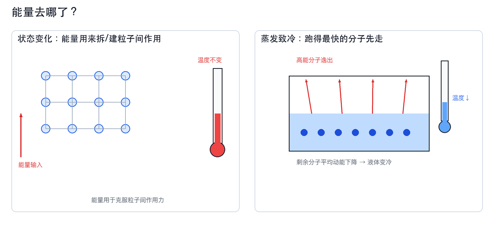
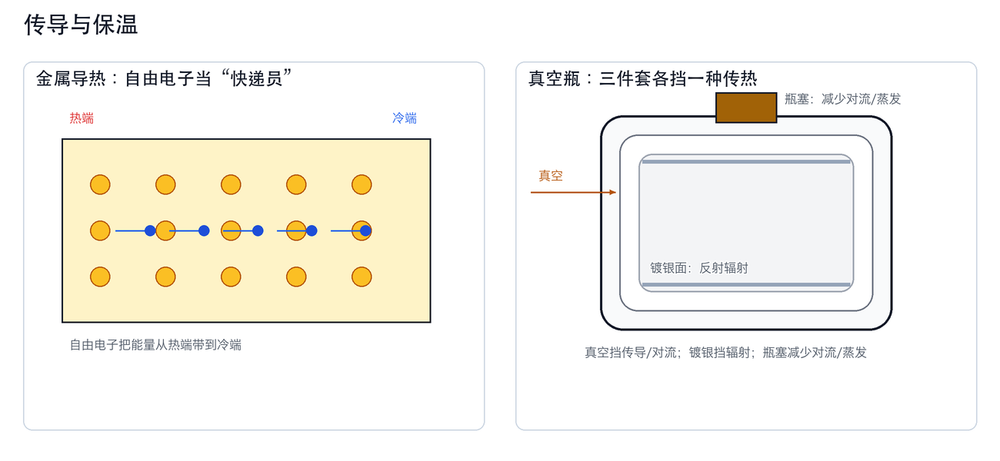

# IGCSE Physics 0625 – Topic 2: Thermal Physics（热物理）
- 这份笔记由 LG-leo 整理和维护。如果你觉得这份笔记对你有帮助，欢迎在 GitHub 上关注我或给我一个 ⭐，这能帮助我持续产出更多免费的学习资源。
- 我的其他课程笔记：https://github.com/LG-leo?tab=repositories
- This note is maintained by LG-leo. If you find it helpful, feel free to follow me or leave a ⭐ on GitHub. It helps me keep producing more free study resources. Check out my other notes: https://github.com/LG-leo?tab=repositories

## 重要说明

本文档依据 **CAIE 0625 Syllabus for 2026, 2027 and 2028**（version 2，2025 年 12 月发布）逐条整理，并结合 Paper 2 / Paper 4 常见考法补充了答题关键词与易错点。

与一些旧资料相比，现行考纲必须注意：

- **不要求潜热计算**：不考 `E = mL`，也不要求背 `L_f`、`L_v` 的数值；熔化、沸腾只做**定性**解释。
- **不要求热容**（thermal capacity，`C = mc`）；比热容只保留 `c = E/(mΔθ)`。
- **气体定律只要求 `pV = 常数`**（Supplement），不要求 `p/T`、`V/T`。
- 旧资料常把「热传递的后果」写成 2.4；现行考纲中它是 **2.3.4**，属于 2.3。

参考来源：

- [CAIE 0625 Syllabus 2026–2028（官方 PDF）](https://www.cambridgeinternational.org/Images/697209-2026-2028-syllabus.pdf)
- [xtremepape.rs](https://papers.xtremepape.rs/) —— 历年真题索引
- [Save My Exams](https://www.savemyexams.com/igcse/physics/cie/23/) —— 按 topic 分类的试题与答案
- [IITian Academy](https://www.iitianacademy.com/igcse-physics/) —— 按 topic 分类的试题与解析
- [IGCSEPhysics.com.my](https://igcsephysics.com.my/topics/thermal-physics) —— 考纲对照笔记
- [CAIE 0625/42 May/June 2023 mark scheme](https://files.pastopic.com/cambridge/0625/0625_s23_ms_42.pdf) 与 [Principal Examiner Report](https://files.pastopic.com/cambridge/0625/0625_s23_er.pdf) —— 核对“绝对零度”的官方评分措辞

---

## Part 1: 考纲结构

| 编号 | 内容 | 中文 | 层级 |
|------|------|------|------|
| 2.1 | Kinetic particle model of matter | 物质的粒子模型 | — |
| 2.1.1 | States of matter | 三态 | Core |
| 2.1.2 | Particle model | 粒子模型 | Core + Supplement |
| 2.1.3 | Gases and the absolute scale of temperature | 气体与绝对温标 | Core + Supplement |
| 2.2 | Thermal properties and temperature | 热性质与温度 | — |
| 2.2.1 | Thermal expansion of solids, liquids and gases | 热膨胀 | Core + Supplement |
| 2.2.2 | Specific heat capacity | 比热容 | Core + Supplement |
| 2.2.3 | Melting, boiling and evaporation | 熔化、沸腾与蒸发 | Core + Supplement |
| 2.3 | Transfer of thermal energy | 热传递 | — |
| 2.3.1 | Conduction | 传导 | Core + Supplement |
| 2.3.2 | Convection | 对流 | Core |
| 2.3.3 | Radiation | 辐射 | Core + Supplement |
| 2.3.4 | Consequences of thermal energy transfer | 热传递的后果 | Core + Supplement |

> 记忆口诀：**三态粒子（2.1）→ 热胀、吸热、变相（2.2）→ 传导、对流、辐射及其后果（2.3）**。

---

## Part 2: 考点整理

### 2.1 物质的粒子模型

#### 2.1.1 三态（Core）

| 状态 | 粒子排列 | 粒子间距 | 粒子运动 | 分子间作用力 | 形状 / 体积 |
|------|----------|----------|----------|--------------|-------------|
| 固体 | 规则排列 | 很小 | 在固定位置**振动** | 很强 | 固定形状、固定体积 |
| 液体 | 不规则 | 较小 | 可滑动，在有限范围内随机运动 | 较弱 | 固定体积、无固定形状 |
| 气体 | 无规则 | 很大 | 高速随机运动，充满容器 | 极弱（近似为零） | 无固定形状和体积 |

- **状态变化的名称**：熔化 melting、凝固/固化 freezing/solidification、沸腾 boiling、蒸发 evaporation、凝结/液化 condensation。
- 考纲明确：**不要求**固体↔气体的直接转换（sublimation / deposition）。
- 三态可通过**粒子模型图**表示（小圆点 + 排列方式）。

**易错点**
- 固体中的粒子**仍在振动**，不是静止不动。
- 气体容易被压缩，是因为粒子**间距大**，不是因为粒子本身变小。
- 液体有固定体积、没有固定形状；气体两者都没有。

#### 2.1.2 粒子模型（Core + Supplement）

**Core**
- **温度**是粒子**平均动能**的量度；温度越高，粒子运动越快。
- **绝对零度**：−273 °C（0 K），是可能达到的最低温度；此时粒子具有**最小动能**。
  - **考试用词（有官方依据）**：`particles have the least kinetic energy`（2023/42 mark scheme，B1）；同一题还要求写出 `lowest possible temperature`（另一 B1）。
  - 2023 examiner report 指出：答对的考生常写 `particles not moving / do not move`，**这不影响得分**；最稳妥仍用 mark scheme 原话。
  - **科学上的严格说法（超出 0625 考纲，不必写进答案）**：0 K 时粒子并非“完全静止”，还存在**零点能 / 零点振动**（量子力学的最低能量，无法被取走）。所以可以写“动能最小”，但不要写“粒子完全没有能量”（还有零点能和分子间势能）。
- **气体压强**的微观解释：气体粒子不断随机运动，**碰撞容器壁**，每次碰撞施加一个很小的力；大量碰撞产生总力，`p = F/A`。
  - 温度升高（体积不变）→ 粒子更快 → 碰撞**更频繁、更有力** → 压强增大。
  - 体积减小（温度不变）→ 碰撞**更频繁**（粒子速率不变）→ 压强增大。
- **布朗运动（Brownian motion）**：悬浮在液体/气体中的**微小粒子**（如烟粒、花粉）做无规则运动。
  - 原因：微粒受到周围**分子/原子随机、不均匀的碰撞**。
  - 意义：布朗运动是**粒子模型（物质由不停运动的微粒组成）的证据**。
  - 注意：看到的是**微粒**，不是分子本身；微粒比分子大得多。

**Supplement**
- 粒子（原子、分子、离子、电子）之间的**作用力和距离**，以及粒子的运动，共同决定物质的性质。
- 气体压强可表述为：粒子碰撞表面产生**力**，压强 = **单位面积上的力**。
- 用词要准确：**atom / molecule** 是粒子种类，**microscopic particle** 指悬浮的微粒（如烟粒）；区分二者。

**易错点**
- 温度只反映**平均**动能，不反映总内能（一杯热水与一滴同温度热水：平均动能相同，一杯水的总内能更大）。
- 布朗运动**不是**分子运动本身，而是分子运动的**间接证据**。
- 0 K 时粒子动能**最小**：写 `not moving` 通常也被接受，但别写成“完全没有能量”（零点能和势能仍在）。

#### 2.1.3 气体与绝对温标（Core + Supplement）

**Core**
- 温度换算：`T(K) = θ(°C) + 273`；温度**间隔**在 K 与 °C 下数值相同（升高 10 °C = 升高 10 K）。
- 定性描述（固定质量气体）：
  - **体积不变**：温度升高 → 压强增大（粒子更快、碰撞更频繁、更猛烈）。
  - **温度不变**：体积减小 → 压强增大（碰撞更频繁，粒子速率不变）。

**Supplement**
- **玻意耳定律**：固定质量气体、温度不变时，`pV = 常数`，即 `p₁V₁ = p₂V₂`。
- 图像：`p–V` 图为曲线（双曲线状）；`p–1/V` 图为过原点的直线。

**易错点**
- 做**温度换算**时别忘 +273；但使用 `pV = 常数` 时温度本身不变，不需要代入温度。
- 等温压缩时，粒子**平均速率不变**，变化的是**碰撞频率**——不能说"粒子变快"。
- 使用 `p₁V₁ = p₂V₂` 时，两次状态的压强、体积单位各自统一即可（如都用 kPa、L）。

---

### 2.2 热性质与温度

#### 2.2.1 热膨胀（Core + Supplement）

- **Core**：定性描述固体、液体、气体在**压强不变**时的热膨胀；举例说明日常应用与后果。
- 现象：加热 → 粒子振动幅度增大 → 平均间距增大 → 体积膨胀。
- 顺序：**气体膨胀最大，液体次之，固体最小**（Supplement 要求用粒子运动与排列解释）。
- 应用：**双金属片**（两种金属膨胀程度不同 → 受热弯曲）用于恒温器/温控开关；温度计。
- 后果：桥梁**伸缩缝**、铁轨留缝、电线夏天松弛等。

**易错点**
- 膨胀不等于"粒子变大"——是**粒子间距**变大。
- 气体膨胀最明显，是因为粒子间作用力最弱、间距最大。
- 热膨胀是**体积**变化；固体线膨胀在考纲中只做定性要求。

#### 2.2.2 比热容（Core + Supplement）

**Core**
- 物体温度升高，**内能增加**。

**Supplement**
- 温度升高 = 粒子**平均动能**增加（内能还包括势能）。
- **比热容（specific heat capacity, c）**：使 **1 kg** 物质温度升高 **1 °C** 所需的能量。
  - 公式：`c = E / (mΔθ)`，等价于 `E = m c Δθ`。
  - 单位：`J/(kg·°C)`（或 `J/(kg·K)`）。
  - 水的比热容 `c = 4200 J/(kg·°C)`，很大 → 升温慢、降温慢 → 适合作冷却剂/储热介质。
- **实验：测固体/液体的比热容**
  - 固体：金属块钻孔插入电热器和温度计，用天平测质量，通电加热并记录电压、电流、时间（`E = IVt`）或焦耳计读数，保温隔热，测温度变化，`c = E/(mΔθ)`。
  - 液体：电热器浸入液体，搅拌使温度均匀，容器保温，其余步骤相同。
  - 关键：**减少热量散失**（隔热、加盖）、**温度均匀**（搅拌）、质量用 **kg**、Δθ 是**温度变化**。

**易错点**
- Δθ 是**温度变化量**（末温 − 初温），不是某一个温度。
- 质量必须换算成 **kg**（500 g = 0.50 kg），否则差 1000 倍。
- 单位写成 `J/kg` 或 `J/°C` 都错，必须是 `J/(kg·°C)`。
- 有热量散失时，测得 **c 偏大**（因为实际用于升温的能量小于计算值）。
- 题目问"末温"时，算出 Δθ 后还要加上初温。
- Core 考生只需知道"升温 → 内能增加"，不要求 `c` 的计算。

#### 2.2.3 熔化、沸腾与蒸发（Core + Supplement）

**Core**
- **熔化/沸腾**：持续输入能量，但**温度不变**；能量用于克服粒子间作用力、改变粒子的排列与间距（增加势能），而不是增加平均动能。
- 水的熔点 **0 °C**、沸点 **100 °C**（标准大气压）。
- **凝结（condensation）**：气体粒子失去能量、运动减慢、彼此靠近 → 形成液体。
- **凝固（solidification）**：液体粒子失去能量 → 排列到固定位置，**仍在振动**。
- **蒸发（evaporation）**：液体**表面**动能较大的粒子逸出成为气体；任何温度下都可发生。
- 蒸发**致冷**：能量最大的粒子先离开 → 剩余粒子平均动能下降 → 液体温度降低。

**Supplement**
- **沸腾 vs 蒸发**：

| 沸腾 boiling | 蒸发 evaporation |
|---|---|
| 在液体**内部和表面**同时发生 | 只在液体**表面**发生 |
| 达到**沸点**时发生 | **任何温度**都可发生 |
| 剧烈、有气泡 | 缓慢、无气泡 |

- 影响蒸发速率的因素：**温度更高、表面积更大、表面空气流动更快**。
- 解释"物体与蒸发中的液体接触会变冷"：液体蒸发吸收能量，使与其接触的物体温度下降；同时蒸发致冷使液体本身温度降低。

**加热曲线（温度–时间图）**
- 斜线段：温度变化，用 `E = mcΔθ` 理解（不要求潜热计算）。
- **水平段（平台）**：状态变化，温度不变，能量用于改变粒子间势能。
  - 同一物质，沸腾平台通常比熔化平台更长（汽化需要更多能量）——只作定性理解。

> ⚠️ 现行 0625 考纲**不要求** `E = mL` 计算，也不要求记忆 `L_f`、`L_v`；只考"为什么温度不变"的定性解释。

**易错点**
- 状态变化时**仍在吸热/放热**，只是温度不变。
- 不能说"固体粒子停止运动"。
- "100 °C 的水一定沸腾"错——必须强调**标准大气压**。
- 蒸发不需要达到沸点；蒸发与沸腾不是同一现象。
- 解释蒸发致冷必须落到"**平均动能下降**"，不能只说"热量跑掉了"。

---

### 2.3 热传递

#### 2.3.1 传导（Conduction，Core + Supplement）

**Core**
- 通过实验比较良导体与不良导体（热绝缘体）：如金属棒与塑料/木棒上蜡的熔化快慢、不同材料包裹热水降温快慢。

**Supplement**
- 所有固体都能通过**晶格振动**传热：热端粒子振动更剧烈，把振动传给相邻粒子。
- **金属**额外依靠**自由电子（free / delocalised electrons）**：电子自由移动，快速把动能从热端带到冷端 → 金属是良导体。
- **气体和大部分液体**导热差：粒子间距大、碰撞传能效率低（气体最差）。
- 固体中：良导体（金属）> 不良导体（如玻璃、塑料）> 热绝缘体；热绝缘体仍能缓慢导热。

**易错点**
- 解释金属导热必须提到**自由电子**，只写"粒子碰撞"拿不到满分。
- 热绝缘体不是"完全不导热"，只是导热很慢。
- 传导是**粒子间传能**，没有**净质量流**（与对流区分）。注意：粒子并非静止——气体导热正是靠分子随机运动与碰撞；只是宏观上没有整体流动。
  - 极端条件下（地幔蠕变、等离子体、超流氦等）可以发生**整体迁移**，但那时传热已属于**对流/流动**，不再是传导；这些超出 0625 考纲。

**延伸（超出考纲，仅供理解）**
- 极高压可使绝缘体**金属化**（如金属氢，约几百 GPa）：本质是电子波函数重叠、出现自由电子，不是原子整体迁移。
- 高压还能诱导**超导**（富氢化合物在 ~150–200 GPa 下 `T_c` 可达 200 K 以上，如 H₃S、LaH₁₀）；超导是**电子配对**导致零电阻，也不是粒子迁移。
- 金属中热导与电导由同一批自由电子承担（Wiedemann–Franz：`κ/σ = LT`）；但超导态下电子热导反而可能下降，不能简单认为“电阻为零 = 导热极好”。
- 极端整体迁移（地幔对流、等离子体流动、超流氦）发生时，传热机制已是**对流/流动**，不是传导。

#### 2.3.2 对流（Convection，Core）

- 对流是**液体和气体**中重要的传热方式；**常温常压下固体不能对流**（极高温高压下固体可通过蠕变缓慢流动，见 2.3.1 的延伸说明）。
- 机制：
  1. 流体受热 → 粒子动能增大 → 膨胀 → **密度减小**。
  2. 密度较小的热流体**上升**。
  3. 密度较大的冷流体**下沉**补充，再被加热。
  4. 形成**对流循环（convection current）**。
- 实验：水中放入高锰酸钾晶体并加热，观察紫色水流；对流管；烟箱。
- 应用：暖气片加热房间、热水循环、海陆风。

**易错点**
- "热空气上升"要写成"**受热流体密度减小而上升**"。
- 对流需要**流体**，且通常需要重力（浮力）；真空中不可能发生。
- 对流是**整体流动**传热，不是粒子振动传递。

#### 2.3.3 辐射（Radiation，Core + Supplement）

**Core**
- 热辐射本质是**红外辐射（infrared radiation）**；**所有物体**都发射红外辐射。
- 辐射**不需要介质**，可在真空中传播（太阳热量传到地球）。
- 表面颜色与质地的影响：
  - **黑色、粗糙（dull）**：良吸收体、良发射体。
  - **白色/浅色、光滑/光亮（shiny）**：不良吸收体、不良发射体，良反射体。

**Supplement**
- 物体温度**恒定**时：向外辐射能量的速率 = 吸收能量的速率。
- 若吸收速率 **<** 向外辐射速率 → 温度下降；若吸收 **>** 辐射 → 温度上升。
- 地球温度取决于**入射太阳辐射**与**地球表面向外辐射**之间的平衡，受云层、温室气体、地表反射率（颜色/反照率）、表面积等因素影响。
- 实验：用**莱斯利立方体（Leslie's cube）** 或黑/银罐头 + 温度计比较不同表面的发射/吸收；用红外灯照射不同表面比较升温。
- 辐射速率还取决于物体的**表面温度**（温度越高越快）和**表面积**（面积越大越快）。

**易错点**
- "黑色吸热"要具体到**吸收红外辐射**；白色/银色是**反射**。
- 所有物体都在辐射，包括"冷"物体；区别在净交换方向。
- 真空瓶的真空层**不能**阻止辐射，只阻止传导和对流。
- 表面越粗糙、越黑，发射与吸收都越强（发射体和吸收体性质一致）。

#### 2.3.4 热传递的后果（Core + Supplement）

**Core**
- 解释日常应用与后果，例如：
  - **厨房锅具**：锅底用金属（良导体，快速把热传给食物）；手柄用塑料/木头（热绝缘体，防止烫手）。
  - **暖气片加热房间**：空气受热上升、冷空气下沉，形成**对流**。
- **真空瓶（vacuum flask）** 综合应用：
  - 双层壁之间的**真空**：阻止传导和对流。
  - **镀银表面**：反射红外辐射，减少辐射。
  - **瓶塞/盖子**：减少对流与蒸发。

**Supplement**
- 分析多种传热方式同时起作用的复杂情境：
  - **燃烧木材/煤炭**：火焰通过**辐射**加热周围；热气体**对流**上升；热量沿金属**传导**。
  - **汽车散热器（radiator）**：发动机热量经金属**传导**给冷却液；冷却液**对流**循环；散热片向空气**辐射**并通过对流散热。
- 回答这类题时，要**逐一说明**涉及哪几种传热方式及各自的证据/机制。

**易错点**
- 不能只说"保温"——要指出每个结构分别阻断哪种传热方式。
- 热传递方向永远是**高温 → 低温**；不能说"冷传进来"。
- 同一情境往往**三种方式并存**，题目问 "more than one type" 时要写全。

---

## Part 2.5: 直观理解（帮助记忆，不考）

- **温度 vs 内能**：温度是“平均每个粒子的动能”，内能是“所有粒子能量总和”；一杯热水与一滴同温水，温度相同但内能不同。
- **三态**：固体粒子“挤在一起原地抖”，液体粒子“挨着但能滑动”，气体粒子“间距大、到处飞”。
- **布朗运动**：像“看不见的人在推乒乓球”；看到的是微粒在动，不是分子本身。
- **气体压强**：粒子不停撞容器壁；加热 → 撞得更快更狠；压缩 → 撞得更频繁。
- **绝对零度**：粒子“动能最小”，不是“完全停止”。
- **比热容**：水像“大油箱”，升温慢、降温慢；沙子像“小油箱”，升温快。
- **状态变化**：温度不变，是因为能量在“拆/建粒子间的作用力”，不是用来加速粒子。
- **蒸发致冷**：跑得最快的分子先逃走，剩下的平均变慢 → 液体变冷（出汗）。
- **传导**：金属有“自由电子快递员”；绝缘体只能靠粒子慢慢传。
- **对流**：热流体变轻上升，冷流体下沉，形成循环。
- **辐射**：所有物体都在发射红外线；黑色粗糙面既善吸也善放，银色面善反射。
- **真空瓶**：真空挡住传导/对流，镀银挡住辐射，瓶塞减少对流/蒸发。

> 图：状态变化时能量用于克服粒子间作用力（温度不变）；蒸发时高能分子先逸出，剩余分子平均动能下降。

> 图：金属靠自由电子把能量从热端带到冷端；真空瓶用真空、镀银面和瓶塞分别阻挡传导/对流、辐射和对流/蒸发。

## Part 3: 必背公式与常量

| 名称 | 公式 | 单位 | 层级 | 条件 |
|------|------|------|------|------|
| 摄氏–开尔文换算 | `T(K) = θ(°C) + 273` | K、°C | Core | 温度间隔 1 K = 1 °C |
| 比热容 | `c = E/(mΔθ)`（即 `E = mcΔθ`） | J/(kg·°C) | Supplement | 无状态变化 |
| 玻意耳定律 | `pV = 常数`（`p₁V₁ = p₂V₂`） | Pa·m³ 等 | Supplement | 固定质量、温度不变 |

常量：水的比热容 `4200 J/(kg·°C)`；水的熔点 `0 °C`、沸点 `100 °C`（标准大气压）。

> 注意：本考纲**没有** `E = mL`，也**没有** `C = mc`、`p/T`、`V/T`。看到这些公式的题目可能来自其他考试局或旧资料。

---

## Part 4: 高频易错点速查

| 错误说法 | 正确理解 |
|---|---|
| 温度高 = 内能大 | 温度反映**平均**动能；内能还与粒子数、势能有关 |
| 0 K 时粒子静止 | 动能**最小**，不是零 |
| 布朗运动就是分子运动 | 是**微粒**的无规则运动，是分子运动的**证据** |
| 压缩气体使粒子变快 | 等温压缩只增加**碰撞频率**，速率不变 |
| 热膨胀 = 粒子变大 | 是**粒子间距**变大 |
| 气体膨胀最小 | 气体膨胀**最大**，固体最小 |
| 比热容单位 J/kg | 是 `J/(kg·°C)` |
| 状态变化时温度升高 | 温度**不变**，能量改变势能 |
| 蒸发只在沸点发生 | 任何温度、只在**表面**发生 |
| 蒸发致冷 = 热量跑掉 | **平均动能下降**，温度降低 |
| 金属手感冷 = 温度低 | 同温；金属**导热快**，迅速带走手上的热 |
| 真空瓶的真空挡辐射 | 真空挡**传导和对流**；辐射靠镀银层反射 |
| 对流可在固体中发生 | 只在**流体**中，靠密度差 |
| 黑色只吸热不散热 | 黑色是良**吸收体**也是良**发射体** |

---

## Part 5: Paper 4 答题模板

- **布朗运动**：Smoke particles are hit unevenly by air molecules moving randomly, so they move in a random path. This is evidence for the kinetic particle model of matter.
- **气体压强**：Gas particles move randomly and collide with the container walls, exerting a force. Pressure is force per unit area; heating makes particles move faster, so collisions become more frequent and more forceful.
- **热膨胀**：Heating increases the kinetic energy of particles, so they vibrate with greater amplitude and the average separation increases, causing expansion.
- **比热容实验**：Use an insulated container, measure the mass with a balance, heat with an electrical heater of known power for a measured time, and measure the temperature rise with a thermometer. `E = Pt = IVt`, then `c = E/(mΔθ)`. Lagging reduces heat loss to the surroundings.
- **状态变化**：Energy supplied is used to overcome the forces between particles (increasing potential energy), not to increase their average kinetic energy, so the temperature stays constant.
- **蒸发致冷**：The most energetic particles escape from the surface, so the average kinetic energy of the remaining particles decreases and the temperature of the liquid falls.
- **传导（金属）**：Metals contain free electrons that move freely and transfer kinetic energy rapidly from the hot end to the cold end, in addition to lattice vibrations.
- **对流**：The fluid near the heat source expands, so its density decreases and it rises. Cooler, denser fluid sinks to replace it, setting up a convection current.
- **辐射**：All objects emit infrared radiation. Black, dull surfaces are good absorbers and emitters; shiny, silvered surfaces are poor absorbers and emitters but good reflectors.
- **真空瓶**：The vacuum between the walls prevents conduction and convection; the silvered surfaces reflect infrared radiation; the stopper reduces convection and evaporation.
- **热平衡**：At constant temperature, the object transfers energy away at the same rate as it receives energy.

---

## Part 6: 关键词词汇表

| 关键词 | 定义 |
|--------|------|
| **Kinetic particle model**（粒子模型） | 所有物质由不停运动的微小粒子组成，粒子运动与温度相关 |
| **Brownian motion**（布朗运动） | 悬浮微粒受周围分子随机碰撞而产生的无规则运动，是粒子模型的证据 |
| **Absolute zero**（绝对零度） | −273 °C（0 K）；可能的最低温度，粒子具有最小动能 |
| **Internal energy**（内能） | 物体内所有粒子的动能与势能之和 |
| **Thermal expansion**（热膨胀） | 加热时粒子间距增大导致的体积增大 |
| **Specific heat capacity**（比热容） | 使 1 kg 物质升温 1 °C 所需的能量，`c = E/(mΔθ)` |
| **Melting / boiling point**（熔点/沸点） | 标准大气压下，水分别为 0 °C 和 100 °C |
| **Condensation / solidification**（凝结/凝固） | 气体→液体 / 液体→固体，粒子失去能量、排列改变 |
| **Evaporation**（蒸发） | 液体表面动能较大的粒子逸出成为气体，任何温度下可发生 |
| **Conduction**（传导） | 通过粒子振动（金属中还有自由电子）传递热能 |
| **Convection**（对流） | 流体因密度差产生整体流动而传热 |
| **Radiation**（辐射） | 以红外辐射传热，不需要介质 |
| **Infrared radiation**（红外辐射） | 热辐射的实质；所有物体都发射 |
| **Emitter / absorber**（发射体/吸收体） | 黑色粗糙表面：良发射体、良吸收体 |
| **Insulator**（热绝缘体） | 导热很慢的材料，如塑料、木头、空气 |
| **Convection current**（对流循环） | 热流体上升、冷流体下沉形成的循环 |
| **Bimetallic strip**（双金属片） | 两种金属粘合，受热因膨胀不同而弯曲 |
| **Vacuum flask**（真空瓶） | 用真空、镀银层和瓶塞分别减少传导、对流和辐射 |
| **Thermal equilibrium**（热平衡） | 物体吸收与辐射能量的速率相等，温度恒定 |

---

## Part 7: 考前自检

1. 能画出固、液、气的粒子模型图，并说出三态区别？
2. 能用粒子碰撞解释气体压强的来源与变化？
3. 布朗运动的完整解释（谁在动、为什么动、证明了什么）？
4. 绝对零度是多少 °C / K？粒子处于什么状态？
5. `T(K) = θ + 273` 会不会用？间隔关系清不清楚？
6. `pV = 常数` 的条件、单位处理和图像？
7. 热膨胀的微观解释与三个应用？
8. `c = E/(mΔθ)` 的变形、单位、实验中如何减少误差？
9. 熔化/沸腾为什么温度不变？蒸发为什么致冷？
10. 传导/对流/辐射的机制、条件、影响因素各是什么？
11. 真空瓶每个部件分别阻断哪种传热方式？
12. 能否对"厨房锅具、暖气、燃烧、汽车散热器"做多方式分析？
