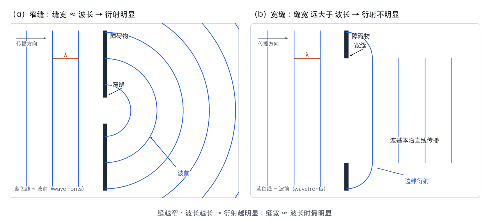

# IGCSE Physics 0625 – Topic 3: Waves（波）
- 这份笔记由 LG-leo 整理和维护。如果你觉得这份笔记对你有帮助，欢迎在 GitHub 上关注我或给我一个 ⭐，这能帮助我持续产出更多免费的学习资源。
- 我的其他课程笔记：https://github.com/LG-leo?tab=repositories
- This note is maintained by LG-leo. If you find it helpful, feel free to follow me or leave a ⭐ on GitHub. It helps me keep producing more free study resources. Check out my other notes: https://github.com/LG-leo?tab=repositories

## 重要说明

本文档依据 **CAIE 0625 Syllabus for 2026, 2027 and 2028**（version 2，2025 年 12 月发布）逐条整理，并参考 Paper 2 / Paper 4 常见考法补充答题关键词与易错点。

与一些旧资料相比，本考纲需要注意：

- **不考干涉（interference）**：0625 只要求反射、折射、衍射。
- **不考透镜公式**（`1/f = 1/u + 1/v`）和放大率公式；薄透镜只考作图、像的性质和矫正视力。
- **不考多普勒效应**，也不考次声波（infrasound）。
- **数字/模拟信号在考纲内**（3.3 Supplement）：要求区别二者、说明数字信号的优点。

参考来源：

- [CAIE 0625 Syllabus 2026–2028（官方 PDF）](https://www.cambridgeinternational.org/Images/697209-2026-2028-syllabus.pdf)
- [xtremepape.rs](https://papers.xtremepape.rs/) —— 历年真题索引
- [Save My Exams](https://www.savemyexams.com/igcse/physics/cie/23/) —— 按 topic 分类的试题与答案
- [IITian Academy](https://www.iitianacademy.com/igcse-physics/) —— 按 topic 分类的试题与解析

---

## Part 1: 考纲结构

| 编号 | 内容 | 中文 | 层级 |
|------|------|------|------|
| 3.1 | General properties of waves | 波的基本性质 | Core + Supplement |
| 3.2 | Light | 光 | — |
| 3.2.1 | Reflection of light | 光的反射 | Core + Supplement |
| 3.2.2 | Refraction of light | 光的折射 | Core + Supplement |
| 3.2.3 | Thin lenses | 薄透镜 | Core + Supplement |
| 3.2.4 | Dispersion of light | 光的色散 | Core + Supplement |
| 3.3 | Electromagnetic spectrum | 电磁波谱 | Core + Supplement |
| 3.4 | Sound | 声 | Core + Supplement |

> 记忆框架：**波怎么动（3.1）→ 光怎么走（3.2）→ 电磁波谱（3.3）→ 声音（3.4）**。

---

## Part 2: 考点整理

### 3.1 波的基本性质

**Core**
- **波传递能量，但不传递物质**：介质中的粒子只在原地振动，能量沿传播方向传递。
- **波的运动**可用绳波、弹簧波以及水波实验说明。
- **波的特征**：
  - **wavefront 波前**：振动相位相同的点连成的面/线；
  - **wavelength λ 波长**：相邻同相位点的距离（峰到峰、密到密）；
  - **frequency f 频率**：每秒通过的完整波数，单位 Hz；
  - **crest 波峰 / trough 波谷**；
  - **amplitude A 振幅**：离平衡位置的最大位移；
  - **wave speed v 波速**：波每秒传播的距离，由**介质**决定。
- `v = f λ`；`T = 1/f`。
- **横波（transverse）**：振动方向**垂直**于传播方向。例：电磁波、水波、地震 S 波。
- **纵波（longitudinal）**：振动方向**平行**于传播方向。例：声波、地震 P 波。
- **波遇到边界/障碍物时**会发生：
  - **反射 reflection**：在平面表面反射，入射角 = 反射角；
  - **折射 refraction**：因**波速改变**而改变方向；
  - **衍射 diffraction**：通过窄缝后扩展。
- **波纹槽（ripple tank）实验**可观察：
  1. 平面反射；
  2. 因**深度改变**导致波速改变而产生的折射；
  3. 通过窄缝的衍射；
  4. 通过边缘的衍射。

> 图：窄缝（缝宽 ≈ 波长）衍射明显；宽缝（缝宽 远大于 波长）波基本沿直线传播。

**Supplement**
- **缝宽**与**波长**共同影响通过窄缝的衍射：缝越窄、波长越长，衍射越明显；缝宽 ≈ 波长时最明显。
- 边缘衍射：波长越长，衍射越明显。

**易错点**
- 波传能量不传物质；介质粒子不随波迁移。
- **频率由波源决定**；波进入不同介质时**频率不变**，波速与波长改变。
- 折射的根本原因是**波速改变**，不是“光想走最短路径”。
- 振幅决定能量/响度；频率决定音调；两者不要混。

---

### 3.2 光

#### 3.2.1 光的反射（Core + Supplement）

**Core**
- 术语：
  - **normal 法线**：垂直于镜面（界面）的线；
  - **angle of incidence 入射角**：入射光线与法线的夹角；
  - **angle of reflection 反射角**：反射光线与法线的夹角。
- **反射定律**：`i = r`（入射角 = 反射角）。
- **平面镜成像特点**：
  - 与物体**等大**；
  - 到镜面距离与物体到镜面距离**相等**；
  - **虚像**（不能在光屏上承接）。
  - 常见补充：正立、左右相反。

**Supplement**
- 能用**简单光路图、测量和计算**处理平面镜反射：确定像的位置、求角度/距离等。

**易错点**
- 所有角度都相对**法线**，不是相对镜面。
- 平面镜成**虚像**，不能投影到光屏。
- 像与物关于镜面对称，不是“像在镜子里”。

#### 3.2.2 光的折射（Core + Supplement）

**Core**
- 术语：normal、angle of incidence、angle of refraction（均相对法线）。
- **折射原因**：光在不同介质中**速度不同**。
  - 空气 → 水/玻璃：速度**变慢** → 向法线偏折；
  - 水/玻璃 → 空气：速度**变快** → 偏离法线。
- **实验**：用不同形状的透明块（矩形、半圆形）和光具座/激光，测量入射角与折射角。
- 只考虑**两种介质边界**上的折射（不涉及多次内部反射）。
- **临界角（critical angle）**：光从光密介质射向光疏介质时，折射角恰好为 90° 所对应的入射角。
- **全内反射（total internal reflection, TIR）**：
  - 条件（缺一不可）：① 从**光密**介质射向**光疏**介质；② 入射角 **大于临界角**。
  - 例子：光纤、棱镜潜望镜、钻石闪耀。

**Supplement**
- **折射率 n** 定义为波在两种介质中**速度之比**：`n = v₁ / v₂`（1 为入射介质，2 为折射介质；从空气进入介质时 `n = c / v`）。
- `n = sin i / sin r`（i 在空气/真空中测量，r 在介质中测量）。
- `n = 1 / sin c`（光从该介质射向空气时的临界角）。
- **光纤**：光在纤芯（n 较大）与包层（n 较小）界面不断发生全内反射，用于通信。

**易错点**
- 折射时**频率不变**，变的是波速和波长。
- 光从空气入水向法线偏折；从水入空气偏离法线——方向别反。
- TIR 两个条件要同时写，只说“角度大”不够。
- `n` 越大，光在介质中越慢、偏折越明显；不要与密度直接等同（但通常光密介质 n 大）。
- 常见现象解释要指明光路方向：筷子“折断”、池水变浅都是“水中 → 空气”。

#### 3.2.3 薄透镜（Core + Supplement）

**Core**
- **凸透镜（converging）**：中间厚，使平行光**会聚**；**凹透镜（diverging）**：中间薄，使平行光**发散**。
- 术语：
  - **principal axis 主光轴**：过透镜中心、垂直于透镜的直线；
  - **principal focus / focal point 主焦点**：平行于主光轴的光线经透镜后会聚（或反向延长后相交）的点；
  - **focal length 焦距**：透镜到主焦点的距离。
- **三条特殊光线**（作图）：
  1. 平行主光轴 → 折射后过主焦点（凹透镜则反向延长线过焦点）；
  2. 过光心 → 方向不变；
  3. 过主焦点 → 折射后平行主光轴。
- 凸透镜成**实像**：倒立，可用光屏承接；像用 enlarged/same size/diminished、upright/inverted、real/virtual 描述。
- **虚像**：出射光线发散，反向延长线相交而成，**不能投影到光屏**。

**Supplement**
- 画**物在焦距内**的凸透镜成像光路图（放大镜）：正立、放大、虚像。
- **放大镜**：单个凸透镜，物距小于焦距。
- **视力矫正**：远视（long-sighted）用**凸透镜**；近视（short-sighted）用**凹透镜**。

**易错点**
- 0625 **不考**透镜公式和放大率公式，不要在这上面浪费时间。
- 实像倒立、虚像正立；实像可投影，虚像不能。
- 作图必须画**至少两条特殊光线**，并标出像的位置与性质。
- 物在焦距内时，出射光发散，像与物同侧。

#### 3.2.4 光的色散（Core + Supplement）

**Core**
- **色散**：白光经玻璃棱镜折射后分解成七色光谱。
- 七色顺序（按频率升高 / 波长减小）：**红、橙、黄、绿、蓝、靛、紫**。
- 棱镜中**紫光偏折最大，红光最小**。

**Supplement**
- 单一频率的光称为 **monochromatic 单色光**。

**易错点**
- 不要记反：紫光频率最高、波长最短、偏折最大。
- 色散是**折射**造成的，不是“棱镜染色”。

---

### 3.3 电磁波谱

**Core**
- **共同性质**：都是横波；在真空中速度相同；不需要介质。
- **顺序**（频率升高 / 波长减小）：
  **无线电波 → 微波 → 红外 → 可见光 → 紫外 → X 射线 → γ 射线**
  （口诀 R M I V U X γ）
- **典型用途**：

| 波段 | 用途（考纲指定） |
|---|---|
| 无线电 radio | 广播/电视、天文、RFID |
| 微波 microwave | 卫星电视、手机、微波炉 |
| 红外 infrared | 电烤炉、短程通信（遥控器、防盗报警）、热成像、光纤 |
| 可见光 visible | 视觉、摄影、照明 |
| 紫外 ultraviolet | 防伪标记、验钞、水消毒 |
| X 射线 | 医学扫描、安检 |
| γ 射线 | 食品/医疗器械灭菌、癌症探测与治疗 |

- **过量暴露的危害**：
  - 微波：使体内细胞**内部加热**；
  - 红外：**皮肤灼伤**；
  - 紫外：损伤**表层细胞和眼睛** → 皮肤癌、眼疾；
  - X/γ：**细胞突变或损伤**。
- **卫星通信**主要用**微波**：部分卫星电话用低轨卫星；部分卫星电话和直播卫星电视用**地球同步卫星**。

**Supplement**
- 真空中电磁波速度 `c = 3.0 × 10⁸ m/s`，在空气中近似相同。
- 通信选择的原因：
  - 手机/无线网络用**微波**：能穿透部分墙壁，天线短；
  - 蓝牙用**无线电**：能穿墙但会减弱；
  - 光纤用**可见光/红外**：玻璃透明，可高速传输数据。
- **数字 vs 模拟信号（analogue / digital）**：模拟信号连续变化；数字信号只有 0/1 两种状态。
- 声音可以用模拟或数字信号传输。
- **数字信号的优点**：数据传输速率更高；可准确再生，因此传输距离更远。

**易错点**
- 所有电磁波在真空中速度相同，不是“频率越高越快”。
- 顺序别记反；γ 射线频率最高。
- 危害要与波段对应：微波是内部加热，紫外是表层细胞/眼睛。
- 微波通信优势是“穿透部分墙壁 + 短天线”，不是“速度快”。

---

### 3.4 声

**Core**
- 声音由**振动源**产生。
- 声波是**纵波**：介质中出现**压缩区与稀疏区**交替。
- **需要介质**：固体、液体、气体都能传声，**真空不能传声**。
- 空气中声速约 **330–350 m/s**（常取 340）。
- **测空气中声速**：测距离 s 和时间 t，`v = s / t`（例如两人相距较远，一人发令、一人看到烟开始计时、听到声停止；或用回声法）。
- 人耳可听频率范围：**20 Hz – 20 000 Hz**。
- **响度**由**振幅**决定；**音调**由**频率**决定。
- **回声**是声波遇到障碍物后的**反射**。
- **超声波（ultrasound）**：频率 **高于 20 kHz**，人耳听不到。

**Supplement**
- **compression 压缩区 / rarefaction 稀疏区**：纵波中粒子密集/稀疏的区域。
- 声速一般：**固体 > 液体 > 气体**。
- **超声波的应用**：
  - 材料**无损检测**（探测内部裂纹）；
  - 医学**软组织扫描**；
  - **声呐（sonar）**测深/测距，并用 `d = v t / 2` 计算。

**易错点**
- 声音不能在真空传播；但电磁波可以。
- 回声测距的 t 是**往返时间**，必须除以 2。
- 超声波是频率 > 20 kHz，不是“速度超过声速”（supersonic）。
- 响度对应振幅，音调对应频率，别混。
- 声速由介质和温度决定，与频率无关。

---

## Part 2.5: 直观理解（帮助记忆，不考）

- **波传能量不传物质**：像体育场“人浪”或麦田波浪——人/麦子只在原地动，波浪却向前传。
- **横波 vs 纵波**：绳子上下抖是横波（振动垂直传播）；弹簧推拉出现疏密是纵波（振动平行传播）。
- **v = fλ**：像队伍过门——每秒过多少人（f）× 每人占多宽（λ）= 队伍前进速度（v）。
- **折射**：车轮从马路进沙地，一边先减速 → 整体转弯；光从空气入水变慢 → 向法线偏。
- **频率不变**：折射时“颜色/频率”不变，变的是波速和波长。
- **衍射**：声波波长长，能绕过门缝；可见光波长短，几乎沿直线。
- **反射**：镜子和回声都是“弹回来”；角度都相对法线量。
- **凸透镜**：三条特殊光线——平行→过焦点、过光心不变、过焦点→平行；实像倒立可投影，虚像正立不能投影。
- **色散**：白光被棱镜“拆开”；紫光偏折最大，红光最小。
- **电磁波**：全家在真空中速度相同；频率越高，波长越短。
- **声**：纵波、需要介质、真空不能传；回声测距 `d = vt/2`，别忘了除以 2。

## Part 3: 必背公式

| 名称 | 公式 | 单位 | 条件/说明 |
|---|---|---|---|
| 波速 | `v = f λ` | m/s、Hz、m | 所有波 |
| 周期 | `T = 1/f` | s、Hz | 所有波 |
| 反射定律 | `i = r` | 度 | 角度相对法线 |
| 折射率（角度） | `n = sin i / sin r` | 无单位 | i 在空气，r 在介质 |
| 折射率（速度） | `n = v₁ / v₂` | 无单位 | 1 入射介质、2 折射介质 |
| 临界角 | `n = 1 / sin c` | 无单位 | 介质 → 空气 |
| 回声/声呐测距 | `d = v t / 2` | m、m/s、s | t 为往返时间 |
| 真空中光速 | `c = 3.0 × 10⁸ m/s` | m/s | 电磁波 |

---

## Part 4: 高频易错点速查

| 错误说法 | 正确理解 |
|---|---|
| 波传播时介质被带着走 | 介质粒子只振动，能量向前传 |
| 机械波能在真空中传播 | 需要介质；真空中无粒子 |
| 所有波都需要介质 | 电磁波不需要 |
| 横波纵波看图形判断 | 看振动方向与传播方向：垂直/平行 |
| 波长是“一个波的长度” | 相邻同相位点距离（峰到峰、密到密） |
| 折射时频率改变 | 频率不变；波速、波长改变 |
| 光从空气入水偏离法线 | 变慢，向法线偏折 |
| 全内反射只需角度大 | 还需“光密 → 光疏” |
| 平面镜像是实像 | 虚像，不能投影 |
| 透镜可用 1/f 公式 | 0625 不考透镜公式 |
| 紫光偏折最小 | 紫光频率最高、偏折最大 |
| 电磁波频率越高速度越快 | 真空中速度都相同 |
| 微波危害是灼伤皮肤 | 微波是体内组织加热；红外才是皮肤灼伤 |
| 回声距离不除 2 | t 是往返时间，`d = vt/2` |
| 超声波 = 超音速 | 超声波指频率 > 20 kHz |

---

## Part 5: Paper 4 答题模板

- **波传递能量**：Waves transfer energy from one place to another without transferring matter; the particles of the medium vibrate about fixed positions.
- **横波/纵波**：In a transverse wave the vibration is perpendicular to the direction of propagation; in a longitudinal wave it is parallel.
- **折射原因**：Light changes speed when it crosses the boundary between two media, so it changes direction (unless it strikes the boundary normally).
- **全内反射**：Total internal reflection occurs when light travels from a denser medium to a less dense medium and the angle of incidence is greater than the critical angle.
- **折射率**：The refractive index is the ratio of the speeds of the wave in the two media, and `n = sin i / sin r`.
- **平面镜**：The image formed by a plane mirror is virtual, the same size as the object and the same distance behind the mirror as the object is in front.
- **凸透镜实像**：A real image is formed where the refracted rays actually meet; it is inverted and can be projected onto a screen.
- **虚像**：A virtual image is formed where the diverging rays appear to come from; it cannot be projected onto a screen.
- **色散**：White light is dispersed by a glass prism because different colours travel at different speeds in glass, so they refract by different amounts; violet bends the most.
- **电磁波**：All electromagnetic waves are transverse, travel at the same speed in a vacuum (`3.0 × 10⁸ m/s`) and do not require a medium.
- **声速测量**：Measure a known distance and the time taken for the sound to travel it, then use `v = s / t`; an echo method uses `v = 2s / t`.
- **声呐/回声**：The pulse travels to the seabed and back, so the depth is `d = v t / 2`; forgetting the factor of 2 gives the total path length.
- **数字信号优点**：Digital signals can be regenerated accurately, so they can travel further, and they allow a higher rate of data transmission.

---

## Part 6: 关键词词汇表

| 关键词 | 定义 |
|---|---|
| **Wave**（波） | 传递能量而不传递物质的扰动 |
| **Transverse wave**（横波） | 振动方向垂直于传播方向 |
| **Longitudinal wave**（纵波） | 振动方向平行于传播方向 |
| **Wavefront**（波前） | 振动相位相同的点连成的线/面 |
| **Wavelength λ**（波长） | 相邻同相位点的距离 |
| **Frequency f**（频率） | 每秒通过的完整波数（Hz） |
| **Amplitude**（振幅） | 离平衡位置的最大位移 |
| **Wave speed**（波速） | 波每秒传播的距离，由介质决定 |
| **Reflection**（反射） | 波在表面返回；入射角 = 反射角 |
| **Refraction**（折射） | 波因速度改变而在边界改变方向 |
| **Diffraction**（衍射） | 波绕过障碍物或通过窄缝后扩展 |
| **Normal**（法线） | 垂直于界面的线 |
| **Angle of incidence**（入射角） | 入射线与法线夹角 |
| **Critical angle**（临界角） | 折射角为 90° 时的入射角 |
| **Total internal reflection**（全内反射） | 光密→光疏且入射角大于临界角时全部反射 |
| **Refractive index n**（折射率） | `n = sin i / sin r = v₁ / v₂` |
| **Principal axis**（主光轴） | 过光心且垂直透镜的直线 |
| **Focal length**（焦距） | 透镜到主焦点的距离 |
| **Principal focus**（主焦点） | 平行主光轴的光线会聚/发散延长线相交的点 |
| **Real image**（实像） | 实际光线相交而成，可投影 |
| **Virtual image**（虚像） | 光线的反向延长线相交而成，不能投影 |
| **Dispersion**（色散） | 白光经棱镜分解为七色 |
| **Monochromatic light**（单色光） | 单一频率的光 |
| **Electromagnetic spectrum**（电磁波谱） | 无线电波到 γ 射线的完整波段 |
| **Analogue signal**（模拟信号） | 连续变化的信号 |
| **Digital signal**（数字信号） | 只有 0/1 两种状态的信号 |
| **Ultrasound**（超声波） | 频率高于 20 kHz 的声波 |
| **Echo**（回声） | 声波的反射 |
| **Compression / rarefaction**（压缩区/稀疏区） | 纵波中粒子密集/稀疏的区域 |

---

## Part 7: 考前自检

1. 能说出波传递能量不传物质，并解释介质粒子如何运动？
2. 横波/纵波的定义与例子（含地震 S/P 波）能分清？
3. 波前、波长、频率、振幅、波速的定义与 `v = fλ` 会用？
4. 能用波纹槽说明反射、折射、衍射（含缝宽与波长的影响）？
5. 反射定律、平面镜成像特点能背？
6. 折射方向、频率不变、临界角、TIR 两个条件能说清？
7. `n = sin i/sin r`、`n = 1/sin c`、`n = v₁/v₂` 会用？
8. 凸透镜三条特殊光线会画？实像/虚像区别能说？
9. 七色顺序与“紫光偏折最大”记牢？
10. 电磁波顺序、用途、危害对应得上？
11. 数字信号的两个优点能写？
12. 声速测量、回声/声呐 `d = vt/2`、超声波应用能答？
