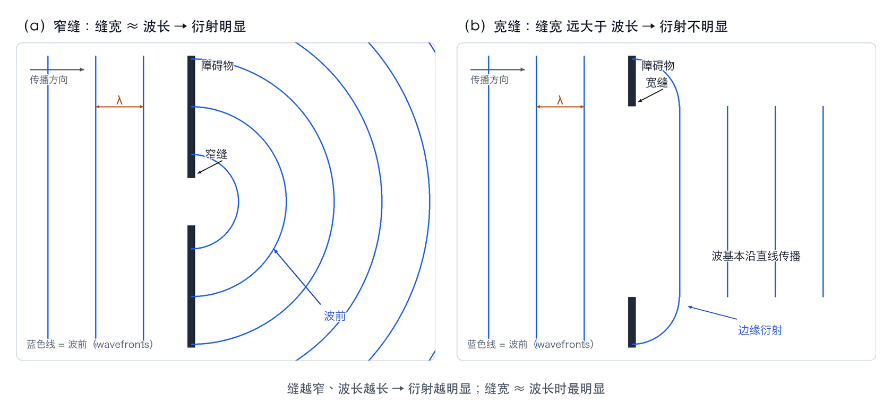

# IGCSE Physics 0625 – Topic 3: Waves
- 这份笔记由 LG-leo 整理和维护。如果你觉得这份笔记对你有帮助，欢迎在 GitHub 上关注我或给我一个 ⭐，这能帮助我持续产出更多免费的学习资源。
- 我的其他课程笔记：https://github.com/LG-leo?tab=repositories
- This note is maintained by LG-leo. If you find it helpful, feel free to follow me or leave a ⭐ on GitHub. It helps me keep producing more free study resources. Check out my other notes: https://github.com/LG-leo?tab=repositories

## Important Notes

This document follows the **CAIE 0625 Syllabus for 2026, 2027 and 2028** (version 2, published December 2025) point by point, and adds exam keywords and common traps based on Paper 2 and Paper 4 questions.

Points to note compared with older resources:

- **No interference**: 0625 requires only reflection, refraction and diffraction.
- **No lens formula** (`1/f = 1/u + 1/v`) and no magnification equation; thin lenses are examined through ray diagrams, image characteristics and vision correction.
- **No Doppler effect** and no infrasound.
- **Digital/analogue signals are in the syllabus** (3.3 Supplement): you must distinguish them and state the benefits of digital signalling.

Sources:

- [CAIE 0625 Syllabus 2026–2028 (official PDF)](https://www.cambridgeinternational.org/Images/697209-2026-2028-syllabus.pdf)
- [xtremepape.rs](https://papers.xtremepape.rs/) – past paper index
- [Save My Exams](https://www.savemyexams.com/igcse/physics/cie/23/) – topic-wise questions and answers
- [IITian Academy](https://www.iitianacademy.com/igcse-physics/) – topic-wise questions

---

## Part 1: Syllabus Structure

| No. | Content | Chinese | Tier |
|-----|---------|---------|------|
| 3.1 | General properties of waves | 波的基本性质 | Core + Supplement |
| 3.2 | Light | 光 | — |
| 3.2.1 | Reflection of light | 光的反射 | Core + Supplement |
| 3.2.2 | Refraction of light | 光的折射 | Core + Supplement |
| 3.2.3 | Thin lenses | 薄透镜 | Core + Supplement |
| 3.2.4 | Dispersion of light | 光的色散 | Core + Supplement |
| 3.3 | Electromagnetic spectrum | 电磁波谱 | Core + Supplement |
| 3.4 | Sound | 声 | Core + Supplement |

> Memory hook: **how waves move (3.1) → how light travels (3.2) → the EM spectrum (3.3) → sound (3.4)**.

---

## Part 2: Knowledge Points

### 3.1 General Properties of Waves

**Core**
- A **wave transfers energy without transferring matter**: particles of the medium vibrate about their equilibrium positions.
- **Wave motion** can be illustrated by vibrations in ropes and springs and by experiments using water waves.
- **Features of a wave**:
  - **wavefront**: a line joining points in phase;
  - **wavelength λ**: distance between consecutive points in phase (crest to crest, compression to compression);
  - **frequency f**: number of complete waves passing a point per second (Hz);
  - **crest / trough**;
  - **amplitude A**: maximum displacement from equilibrium;
  - **wave speed v**: distance travelled per second; determined by the **medium**.
- `v = f λ`; `T = 1/f`.
- **Transverse wave**: vibration is **perpendicular** to the direction of propagation. Examples: electromagnetic radiation, water waves, seismic S-waves.
- **Longitudinal wave**: vibration is **parallel** to the direction of propagation. Examples: sound waves, seismic P-waves.
- **Waves can undergo**:
  - **reflection** at a plane surface (angle of incidence = angle of reflection);
  - **refraction** due to a change of speed;
  - **diffraction** through a narrow gap.
- **Ripple tank experiments** show:
  1. reflection at a plane surface;
  2. refraction due to a change in speed caused by a change in depth;
  3. diffraction at a gap;
  4. diffraction at an edge.

> Figure: diffraction is obvious when the gap width is about one wavelength; with a wide gap the waves travel almost in straight lines.

**Supplement**
- **Wavelength** and **gap size** affect diffraction through a gap: the narrower the gap and the longer the wavelength, the more the waves spread; diffraction is most obvious when gap width ≈ wavelength.
- At an edge, a longer wavelength produces more diffraction.

**Common traps**
- Waves transfer energy, not matter; particles do not travel with the wave.
- **Frequency is determined by the source**; when a wave enters a new medium, the frequency stays the same while speed and wavelength change.
- Refraction is caused by a **change of speed**, not by light "choosing the shortest path".
- Amplitude determines energy/loudness; frequency determines pitch – do not mix them.

---

### 3.2 Light

#### 3.2.1 Reflection of Light (Core + Supplement)

**Core**
- Terms:
  - **normal**: the line perpendicular to the mirror/surface;
  - **angle of incidence**: angle between the incident ray and the normal;
  - **angle of reflection**: angle between the reflected ray and the normal.
- **Law of reflection**: `i = r`.
- **Image formed by a plane mirror**:
  - **same size** as the object;
  - **same distance** behind the mirror as the object is in front;
  - **virtual** (cannot be projected on a screen).
  - Commonly added: upright and laterally inverted.

**Supplement**
- Use **simple constructions, measurements and calculations** for reflection by plane mirrors: locate the image, calculate angles and distances.

**Common traps**
- All angles are measured from the **normal**, not from the mirror surface.
- A plane mirror forms a **virtual** image that cannot be projected.
- The image is symmetrical with the object about the mirror.

#### 3.2.2 Refraction of Light (Core + Supplement)

**Core**
- Terms: normal, angle of incidence, angle of refraction (all measured from the normal).
- **Cause**: light travels at **different speeds** in different media.
  - air → water/glass: slower → bends **towards** the normal;
  - water/glass → air: faster → bends **away** from the normal.
- **Experiment**: use transparent blocks of different shapes (rectangular, semicircular) with a ray box and protractor; measure i and r.
- Only consider refraction at the **boundary between two media** (no repeated internal reflections).
- **Critical angle**: the angle of incidence in the denser medium for which the angle of refraction is 90°.
- **Total internal reflection (TIR)**:
  - both conditions required: (1) light travels from a **denser** to a **less dense** medium; (2) the angle of incidence is **greater than the critical angle**.
  - Examples: optical fibres, prism periscopes, diamond sparkle.

**Supplement**
- **Refractive index n** is the ratio of the speeds of the wave in the two media: `n = v₁ / v₂` (1 = incident medium, 2 = refracting medium; from air into a medium, `n = c / v`).
- `n = sin i / sin r` (i measured in air/vacuum, r in the medium).
- `n = 1 / sin c` (for light going from the medium into air).
- **Optical fibres**: light undergoes repeated total internal reflection at the core (higher n) – cladding (lower n) boundary; used in telecommunications.

**Common traps**
- The **frequency does not change** during refraction; speed and wavelength do.
- Air → water bends towards the normal; water → air bends away – do not reverse them.
- For TIR, state **both** conditions, not just "large angle".
- The larger n is, the slower light travels and the more it bends.
- Everyday explanations must state the direction of the light: a "broken" pencil and a shallower pool both involve light travelling **from water into air**.

#### 3.2.3 Thin Lenses (Core + Supplement)

**Core**
- **Converging lens**: thicker in the middle, brings a parallel beam to a focus; **diverging lens**: thinner in the middle, spreads a parallel beam.
- Terms:
  - **principal axis**: the line through the centre of the lens, perpendicular to the lens;
  - **principal focus / focal point**: the point where rays parallel to the principal axis converge (or appear to diverge from);
  - **focal length**: distance from the lens to the principal focus.
- **Three special rays** (ray diagrams):
  1. parallel to the principal axis → passes through the principal focus after refraction (for a diverging lens, the backward extension passes through the focus);
  2. through the optical centre → continues undeviated;
  3. through the principal focus → emerges parallel to the principal axis.
- A **real image** formed by a converging lens is inverted and can be projected on a screen; describe images using enlarged/same size/diminished, upright/inverted and real/virtual.
- A **virtual image** is formed where diverging rays are extrapolated backwards; it **cannot be projected on a screen**.

**Supplement**
- Draw ray diagrams for a **virtual image** formed by a converging lens (object inside the focal length) – the magnifying glass.
- **Magnifying glass**: a single converging lens with the object closer than the focal length.
- **Vision correction**: long-sightedness with a **converging** lens; short-sightedness with a **diverging** lens.

**Common traps**
- 0625 does **not** require the lens formula or magnification equation – do not waste time on them.
- Real images are inverted; virtual images are upright.
- Always draw **at least two special rays** and mark the image position and characteristics.
- When the object is inside the focal length, the rays diverge and the image is on the same side as the object.

#### 3.2.4 Dispersion of Light (Core + Supplement)

**Core**
- **Dispersion**: white light is split into the seven colours when refracted by a glass prism.
- Order of the seven colours (increasing frequency / decreasing wavelength): **red, orange, yellow, green, blue, indigo, violet**.
- In a prism, **violet bends the most** and red the least.

**Supplement**
- Light of a single frequency is described as **monochromatic**.

**Common traps**
- Do not reverse the order: violet has the highest frequency, shortest wavelength and bends the most.
- Dispersion is caused by **refraction**, not by the prism "colouring" the light.

---

### 3.3 Electromagnetic Spectrum

**Core**
- **Common properties**: all are transverse; all travel at the same speed in a vacuum; no medium is required.
- **Order** (increasing frequency / decreasing wavelength):
  **radio → microwave → infrared → visible → ultraviolet → X-ray → gamma ray**
  (mnemonic: R M I V U X γ)
- **Typical uses** (syllabus):

| Region | Uses |
|---|---|
| Radio waves | radio and TV transmissions, astronomy, RFID |
| Microwaves | satellite television, mobile phones, microwave ovens |
| Infrared | electric grills, short-range communications (TV remote controls, intruder alarms), thermal imaging, optical fibres |
| Visible light | vision, photography, illumination |
| Ultraviolet | security marking, detecting fake banknotes, sterilising water |
| X-rays | medical scanning, security scanners |
| Gamma rays | sterilising food and medical equipment, detection and treatment of cancer |

- **Harmful effects of excessive exposure**:
  - microwaves: internal heating of body cells;
  - infrared: skin burns;
  - ultraviolet: damage to surface cells and eyes, leading to skin cancer and eye conditions;
  - X-rays and gamma rays: mutation or damage to cells in the body.
- **Satellite communication** mainly uses **microwaves**: some satellite phones use low-orbit satellites; some satellite phones and direct broadcast satellite television use **geostationary** satellites.

**Supplement**
- The speed of electromagnetic waves in a vacuum is `c = 3.0 × 10⁸ m/s`, approximately the same in air.
- Reasons for communication choices:
  - mobile phones / wireless internet use **microwaves** because they can penetrate some walls and require only a short aerial;
  - Bluetooth uses **radio waves** because they pass through walls but are weakened;
  - optical fibres use **visible light or infrared** because glass is transparent to them and they can carry high data rates.
- **Digital vs analogue signals**: an analogue signal varies continuously; a digital signal has only two states (0 and 1).
- Sound can be transmitted as a digital or an analogue signal.
- **Benefits of digital signalling**: a higher rate of data transmission and a greater range because the signal can be regenerated accurately.

**Common traps**
- All electromagnetic waves have the **same speed in a vacuum**; higher frequency does not mean faster.
- Keep the order correct; gamma rays have the highest frequency.
- Match the hazard to the region: microwaves heat body cells internally; ultraviolet damages surface cells and eyes.
- The advantage of microwaves for communication is penetration of walls and a short aerial, not "higher speed".

---

### 3.4 Sound

**Core**
- Sound is produced by **vibrating sources**.
- Sound waves are **longitudinal**: regions of **compression** and **rarefaction** travel through the medium.
- A **medium is needed**; sound cannot travel through a vacuum.
- The speed of sound in air is approximately **330–350 m/s** (often taken as 340 m/s).
- **Measuring the speed of sound in air**: measure a known distance s and the time t taken, then `v = s / t` (e.g. two observers far apart: one fires a starting pistol, the other starts a stopwatch on seeing the flash and stops on hearing the sound; or use an echo method).
- Audible range for humans: **20 Hz – 20 000 Hz**.
- **Loudness** depends on **amplitude**; **pitch** depends on **frequency**.
- An **echo** is the reflection of sound.
- **Ultrasound**: sound with a frequency **above 20 kHz**, inaudible to humans.

**Supplement**
- **Compression and rarefaction**: regions where particles are closer together / further apart in a longitudinal wave.
- In general, sound travels **faster in solids than in liquids**, and **faster in liquids than in gases**.
- **Uses of ultrasound**:
  - non-destructive testing of materials (detecting internal cracks);
  - medical scanning of soft tissue;
  - **sonar** for depth/distance, using `d = v t / 2`.

**Common traps**
- Sound cannot travel through a vacuum, but electromagnetic waves can.
- For echoes, t is the **round-trip** time, so divide by 2.
- Ultrasound means frequency > 20 kHz, not "faster than sound" (supersonic).
- Loudness ↔ amplitude; pitch ↔ frequency – do not swap them.
- The speed of sound depends on the medium and temperature, not on frequency.

---

## Part 2.5: Intuitive Understanding (for memory, not examined)

- **Waves transfer energy, not matter**: like a "stadium wave" or waves across a wheat field – the people/wheat move only on the spot, but the wave travels forward.
- **Transverse vs longitudinal**: shaking a rope up and down gives a transverse wave (vibration perpendicular to propagation); pushing and pulling a spring gives compressions and rarefactions – a longitudinal wave (vibration parallel to propagation).
- **v = fλ**: like people walking through a door – the number passing per second (f) × the space each person takes (λ) = the speed of the queue (v).
- **Refraction**: a cart wheel entering sand slows on one side first and turns; light slowing down on entering water bends towards the normal.
- **Frequency stays the same**: during refraction the "colour"/frequency does not change; the speed and wavelength do.
- **Diffraction**: sound has a long wavelength, so it bends around a doorway; visible light has a very short wavelength, so it travels almost in straight lines.
- **Reflection**: mirrors and echoes both "bounce back"; angles are measured from the normal.
- **Converging lens**: three special rays – parallel → through the focus, through the optical centre → undeviated, through the focus → parallel. Real images are inverted and can be projected; virtual images are upright and cannot.
- **Dispersion**: a prism "splits" white light; violet bends the most and red the least.
- **EM waves**: all have the same speed in a vacuum; the higher the frequency, the shorter the wavelength.
- **Sound**: longitudinal, needs a medium, cannot travel through a vacuum; for echo distance `d = vt/2` – do not forget the factor of 2.

## Part 3: Equations and Constants

| Quantity | Equation | Unit | Condition/notes |
|---|---|---|---|
| Wave speed | `v = f λ` | m/s, Hz, m | all waves |
| Period | `T = 1/f` | s, Hz | all waves |
| Law of reflection | `i = r` | degrees | angles measured from the normal |
| Refractive index (angles) | `n = sin i / sin r` | none | i in air, r in medium |
| Refractive index (speeds) | `n = v₁ / v₂` | none | 1 = incident medium, 2 = refracting medium |
| Critical angle | `n = 1 / sin c` | none | medium → air |
| Echo / sonar distance | `d = v t / 2` | m, m/s, s | t is the round-trip time |
| Speed of light in vacuum | `c = 3.0 × 10⁸ m/s` | m/s | electromagnetic waves |

---

## Part 4: Common Traps

| Wrong statement | Correct understanding |
|---|---|
| Waves carry the medium along | Particles vibrate; energy travels |
| Mechanical waves travel in a vacuum | They need a medium |
| All waves need a medium | EM waves do not |
| Judge transverse/longitudinal by the graph shape | Judge by vibration direction relative to propagation |
| Wavelength = "length of one wave" | Distance between consecutive points in phase |
| Frequency changes during refraction | Frequency is constant; speed and wavelength change |
| Air → water bends away from the normal | It slows down and bends towards the normal |
| TIR needs only a large angle | Also needs denser → less dense medium |
| Plane mirror image is real | Virtual, cannot be projected |
| Use `1/f = 1/u + 1/v` in 0625 | Not required by the syllabus |
| Violet bends least | Violet has the highest frequency and bends most |
| Higher frequency → faster in vacuum | All EM waves have the same speed in a vacuum |
| Microwaves burn the skin | Microwaves heat body cells internally; infrared burns skin |
| Echo distance without ÷2 | t is round-trip; `d = vt/2` |
| Ultrasound = supersonic | Ultrasound means frequency > 20 kHz |

---

## Part 5: Paper 4 Answer Templates

- **Wave energy**: Waves transfer energy from one place to another without transferring matter; the particles of the medium vibrate about fixed positions.
- **Transverse/longitudinal**: In a transverse wave the vibration is perpendicular to the direction of propagation; in a longitudinal wave it is parallel.
- **Refraction**: Light changes speed when it crosses the boundary between two media, so it changes direction (unless it strikes the boundary normally).
- **TIR**: Total internal reflection occurs when light travels from a denser medium to a less dense medium and the angle of incidence is greater than the critical angle.
- **Refractive index**: The refractive index is the ratio of the speeds of the wave in the two media, and `n = sin i / sin r`.
- **Plane mirror**: The image formed by a plane mirror is virtual, the same size as the object and the same distance behind the mirror as the object is in front.
- **Real image**: A real image is formed where the refracted rays actually meet; it is inverted and can be projected onto a screen.
- **Virtual image**: A virtual image is formed where the diverging rays appear to come from; it cannot be projected onto a screen.
- **Dispersion**: White light is dispersed by a glass prism because different colours travel at different speeds in glass, so they refract by different amounts; violet bends the most.
- **EM waves**: All electromagnetic waves are transverse, travel at the same speed in a vacuum (`3.0 × 10⁸ m/s`) and do not require a medium.
- **Speed of sound**: Measure a known distance and the time taken for the sound to travel it, then use `v = s / t`; an echo method uses `v = 2s / t`.
- **Sonar**: The pulse travels to the seabed and back, so the depth is `d = v t / 2`; forgetting the factor of 2 gives the total path length.
- **Digital signals**: Digital signals can be regenerated accurately, so they can travel further, and they allow a higher rate of data transmission.

---

## Part 6: Keyword Glossary

| Keyword | Definition |
|---|---|
| **Wave** | a disturbance that transfers energy without transferring matter |
| **Transverse wave** | vibration perpendicular to the direction of propagation |
| **Longitudinal wave** | vibration parallel to the direction of propagation |
| **Wavefront** | a line joining points that are in phase |
| **Wavelength λ** | distance between consecutive points in phase |
| **Frequency f** | number of complete waves passing a point per second (Hz) |
| **Amplitude** | maximum displacement from the equilibrium position |
| **Wave speed** | distance travelled per second; determined by the medium |
| **Reflection** | wave returns at a surface; angle of incidence = angle of reflection |
| **Refraction** | change of direction at a boundary due to a change of speed |
| **Diffraction** | spreading of waves around obstacles or through a narrow gap |
| **Normal** | line perpendicular to the surface/boundary |
| **Angle of incidence** | angle between the incident ray and the normal |
| **Critical angle** | angle of incidence for which the angle of refraction is 90° |
| **Total internal reflection** | complete reflection when light goes from denser to less dense medium with i > c |
| **Refractive index n** | `n = sin i / sin r = v₁ / v₂` |
| **Principal axis** | line through the centre of the lens, perpendicular to it |
| **Focal length** | distance from the lens to the principal focus |
| **Principal focus** | point where rays parallel to the principal axis converge (or appear to diverge from) |
| **Real image** | formed by actual rays; can be projected |
| **Virtual image** | formed by backward extensions of rays; cannot be projected |
| **Dispersion** | splitting of white light into the seven colours by a prism |
| **Monochromatic light** | light of a single frequency |
| **Electromagnetic spectrum** | the full range from radio waves to gamma rays |
| **Analogue signal** | a continuously varying signal |
| **Digital signal** | a signal with only two states (0 and 1) |
| **Ultrasound** | sound with frequency above 20 kHz |
| **Echo** | reflection of sound |
| **Compression / rarefaction** | regions of high/low particle density in a longitudinal wave |

---

## Part 7: Final Self-check

1. Can you explain that waves transfer energy but not matter, and how particles move?
2. Can you distinguish transverse and longitudinal waves, including seismic S/P waves?
3. Do you know wavefront, wavelength, frequency, amplitude and wave speed, and can you use `v = fλ`?
4. Can you use the ripple tank to explain reflection, refraction and diffraction (including gap/wavelength effects)?
5. Can you state the law of reflection and the image characteristics of a plane mirror?
6. Can you explain refraction direction, constant frequency, critical angle and the two TIR conditions?
7. Can you use `n = sin i/sin r`, `n = 1/sin c` and `n = v₁/v₂`?
8. Can you draw the three special rays for a converging lens and distinguish real/virtual images?
9. Do you know the order of the seven colours and that violet bends the most?
10. Can you match EM regions to uses and hazards?
11. Can you state the two benefits of digital signalling?
12. Can you explain speed-of-sound measurement, echoes/sonar (`d = vt/2`) and ultrasound uses?
