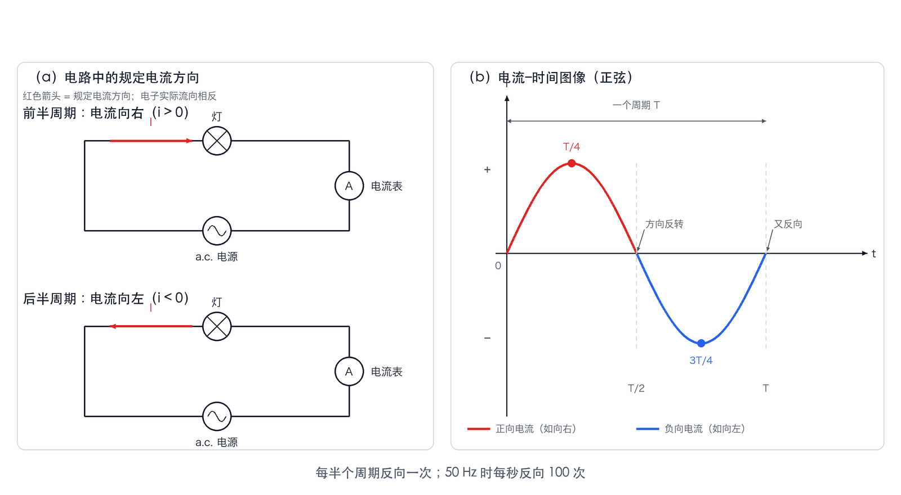

# IGCSE Physics 0625 – Topic 4: Electricity and Magnetism（电与磁）
- 这份笔记由 LG-leo 整理和维护。如果你觉得这份笔记对你有帮助，欢迎在 GitHub 上关注我或给我一个 ⭐，这能帮助我持续产出更多免费的学习资源。
- 我的其他课程笔记：https://github.com/LG-leo?tab=repositories
- This note is maintained by LG-leo. If you find it helpful, feel free to follow me or leave a ⭐ on GitHub. It helps me keep producing more free study resources. Check out my other notes: https://github.com/LG-leo?tab=repositories

## 重要说明

本文档依据 **CAIE 0625 Syllabus for 2026, 2027 and 2028**（version 2，2025 年 12 月发布）逐条整理，并参考 Paper 2 / Paper 4 常见考法补充答题关键词与易错点。

与一些旧资料相比，本考纲需要注意：

- **不考数字电子学 / 逻辑门**（NOT、AND、OR 等已不在 0625 中）。
- **数字/模拟信号**现在属于 **Topic 3 的 3.3 Supplement**，不在 Topic 4。
- 现行结构：**4.4 是 Electrical safety（用电安全）**，**4.5 是 Electromagnetic effects（电磁效应）**；旧资料的“4.4 Digital electronics、4.5 Dangers、4.6 EM effects”编号已经过时。
- **4.5.2 交流发电机只属于 Supplement（Extended）**。

参考来源：

- [CAIE 0625 Syllabus 2026–2028（官方 PDF）](https://www.cambridgeinternational.org/Images/697209-2026-2028-syllabus.pdf)
- [xtremepape.rs](https://papers.xtremepape.rs/) —— 历年真题索引
- [Save My Exams](https://www.savemyexams.com/igcse/physics/cie/23/) —— 按 topic 分类的试题与答案
- [IITian Academy](https://www.iitianacademy.com/igcse-physics/) —— 按 topic 分类的试题与解析

---

## Part 1: 考纲结构

| 编号 | 内容 | 中文 | 层级 |
|------|------|------|------|
| 4.1 | Simple phenomena of magnetism | 简单磁现象 | Core + Supplement |
| 4.2 | Electrical quantities | 电学量 | — |
| 4.2.1 | Electric charge | 电荷 | Core + Supplement |
| 4.2.2 | Electric current | 电流 | Core + Supplement |
| 4.2.3 | Electromotive force and potential difference | 电动势与电势差 | Core + Supplement |
| 4.2.4 | Resistance | 电阻 | Core + Supplement |
| 4.2.5 | Electrical energy and electrical power | 电能与电功率 | Core |
| 4.3 | Electric circuits | 电路 | — |
| 4.3.1 | Circuit diagrams and circuit components | 电路图与元件 | Core + Supplement |
| 4.3.2 | Series and parallel circuits | 串联与并联 | Core + Supplement |
| 4.3.3 | Action and use of circuit components | 元件的作用 | Core + Supplement |
| 4.4 | Electrical safety | 用电安全 | Core |
| 4.5 | Electromagnetic effects | 电磁效应 | — |
| 4.5.1 | Electromagnetic induction | 电磁感应 | Core + Supplement |
| 4.5.2 | The a.c. generator | 交流发电机 | Supplement |
| 4.5.3 | Magnetic effect of a current | 电流的磁效应 | Core + Supplement |
| 4.5.4 | Force on a current-carrying conductor | 磁场对通电导体的力 | Core + Supplement |
| 4.5.5 | The d.c. motor | 直流电动机 | Core + Supplement |
| 4.5.6 | The transformer | 变压器 | Core + Supplement |

> 记忆框架：**磁（4.1）→ 电学量（4.2）→ 电路（4.3）→ 安全（4.4）→ 电磁效应（4.5）**。

---

## Part 2: 考点整理

### 4.1 简单磁现象

**Core**
- 磁极：**N 极（north pole）** 与 **S 极（south pole）**；**同名磁极相斥，异名磁极相吸**（repulsion / attraction）。
- 磁铁能吸引**磁性材料**（magnetic materials）：铁、钢、镍、钴；不能吸引**非磁性材料**：铜、铝、塑料、玻璃、木材。
- **诱导磁性（induced magnetism）**：磁性材料靠近磁铁后被磁化；靠近磁极的一端出现**相反磁极**，远离的一端出现同名磁极。
- **暂时磁铁 vs 永久磁铁**：
  - **软铁（soft iron）**：易磁化、易退磁 → 用作**电磁铁芯**（暂时磁铁）。
  - **钢（steel）**：较难磁化、能保持磁性 → 用作**永久磁铁**。
- **磁场**：磁极受到磁力的区域。
- **磁场方向**：放在该点的小磁针 **N 极受力方向**。
- **条形磁铁的磁感线**：外部从 **N 极到 S 极**，内部从 S 极到 N 极；磁感线**不相交**。
- 用**铁屑**显示磁感线形状，用**小磁针（plotting compass）** 确定方向。
- **用途**：
  - 永久磁铁：指南针、扬声器中的永磁体、门吸、冰箱贴；
  - 电磁铁：起重机、继电器、电动机、发电机、扬声器线圈。

**Supplement**
- 磁力来源于**磁场之间的相互作用**。
- 磁感线的**疏密**表示磁场的相对强弱：越密越强。

**易错点**
- 磁感线是**假想线**，不是真实存在的线；磁感线不会相交。
- 磁铁吸引的是**磁性材料**，不是所有金属（铜、铝不被吸引）。
- 软铁适合做电磁铁芯，**不适合**做永久磁铁；钢适合做永久磁铁。
- 诱导磁性的磁极方向：靠近磁铁的一端与磁铁该极**相反**。

---

### 4.2 电学量

#### 4.2.1 电荷与电场（Core + Supplement）

**Core**
- 两种电荷：**正电荷（positive）** 与 **负电荷（negative）**。
- **同种电荷相斥，异种电荷相吸**。
- **摩擦起电**实验：用塑料尺/气球摩擦后吸引纸屑；用**验电器（electroscope）** 检测电荷。
- **摩擦起电的实质**：只有**负电荷（电子）** 发生转移，质子不移动。
  - 失去电子 → 带正电；得到电子 → 带负电。
- **导体与绝缘体实验**：用不同材料连接/接触验电器，观察电荷能否转移。
- **电子模型**：
  - 导体（铜、铝、石墨）：有**自由电子**，电荷容易移动；
  - 绝缘体（塑料、玻璃、干木头）：电子被束缚，电荷不易移动。

**Supplement**
- 电荷单位：**库仑（coulomb, C）**。
- **电场（electric field）**：电荷受到力的区域。
- **电场方向**：**正电荷**在该点受力方向。
- **电场图样**：
  - 点电荷周围：放射状；
  - 带电导体球外部：类似点电荷的放射状；
  - 两块带异种电荷的平行金属板之间：**匀强电场**，方向从正极板指向负极板。
- 考纲说明：**边缘效应（edge effects）不考**。

**易错点**
- 摩擦起电转移的是**电子**，不是质子；正电荷不会移动。
- 电场方向是**正电荷**受力方向；负电荷受力方向相反。
- 不带电的轻小物体也会被带电体吸引（因诱导极化），不能据此判断它带异种电荷。

#### 4.2.2 电流（Core + Supplement）

**Core**
- 电流与**电荷的流动**有关。
- **电流表（ammeter）**：**串联**接入电路；模拟/数字电流表有不同量程。
- **金属导电**：靠**自由电子的定向移动**。
- **直流（d.c.）**：电流方向不变；**交流（a.c.）**：电流方向周期性改变。

> 图：a.c. 的电流方向每半个周期反转一次；红色/蓝色分别表示两个相反的电流方向。

**Supplement**
- `I = Q / t`，单位安培（A），1 A = 1 C/s。
- **规定电流方向（conventional current）**：从电源**正极**经外电路到**负极**。
- **自由电子实际流向**：与规定电流方向**相反**（从负极到正极）。

**延伸理解（超出考纲，帮助理解）**
- **电子跑得很慢**：铜导线中约 1 A 时，电子定向漂移速度只有**mm/s 量级甚至更小**；电子本身的热运动速度约 **10⁶ m/s**，但方向随机，并不形成电流。
- **交流电中电子只是原地振荡**：50 Hz 时电子位移振幅约**亚微米**，一个周期净位移几乎为零；电流方向变了，但电子并没有“从发电厂跑到家里”。
- **灯为什么瞬间亮**：电场/电磁场以接近光速建立并传递能量，不是电子跑得快。
- ⚠️ 0625 不要求漂移速度、振幅的具体数值；这些用于理解，不要写进考试答案。

**易错点**
- 规定电流方向与电子流向相反。
- 电流表必须串联；并联会短路/损坏。
- 电流是“电荷流动率”，不是“电荷量”。

#### 4.2.3 电动势与电势差（Core + Supplement）

**Core**
- **电动势（e.m.f.）**：电源把**单位电荷**沿**完整回路**移动所做的电功；单位**伏特（V）**。
- **电势差（p.d.）**：**单位电荷通过某个元件**时所做的功；单位**伏特（V）**。
- **电压表（voltmeter）**：**并联**接在被测元件/电源两端；模拟/数字电压表有不同量程。

**Supplement**
- `E = W / Q`（e.m.f.）
- `V = W / Q`（p.d.）

**易错点**
- e.m.f. 与 p.d. 都是“每单位电荷的功”，但 e.m.f. 对应**电源/整个回路**，p.d. 对应**某个元件**；单位都是 V。
- 电压表并联，不能串联。

#### 4.2.4 电阻（Core + Supplement）

**Core**
- 电阻定义式：`R = V / I`，单位**欧姆（Ω）**。
- **测电阻实验**：
  - 电流表**串联**、电压表**并联**在待测电阻两端；
  - 用可变电阻改变电流，记录多组 U、I；
  - 计算 `R = V / I`。
- **金属导线电阻的定性关系**：
  - 导线**越长**，电阻越大；
  - **横截面积越大**，电阻越小。

**Supplement**
- **I–V 图像**：
  - **固定电阻**：过原点的直线（电阻恒定）；
  - **灯丝（filament lamp）**：曲线；电流增大、温度升高 → 电阻增大 → 曲线变平；
  - **二极管（diode）**：正向电压超过一定值才明显导通；反向几乎不导电。
- 定量关系：`R ∝ L`；`R ∝ 1 / A`。

**易错点**
- `R = V/I` 是电阻的**定义式**；灯丝和二极管不满足“I 与 V 成正比”，它们的 I–V 图不是直线。
- 温度升高时，金属电阻**增大**（灯丝更明显）。
- 测电阻时电压表并联、电流表串联，接反会出错。

#### 4.2.5 电能与电功率（Core）

- 电路把电能从电源（电池/市电）传给元件，再转化为其他形式散失到环境。
- 电功率：`P = I V`，单位**瓦特（W）**。
- 电能：`E = I V t`，单位**焦耳（J）**。
- **千瓦时（kWh）**：能量单位；`1 kWh = 3.6 × 10⁶ J`。
- 电费：`费用 = 能耗(kWh) × 单价`。

**易错点**
- 用 kWh 算电费时，功率用 **kW**、时间用 **h**；用 J 时 P 用 W、t 用 s。
- 1 kWh 不是 1 J，而是 3.6×10⁶ J。
- P=IV 中 I 是电流、V 是**该元件两端**的电压。

---

### 4.3 电路

#### 4.3.1 电路图与元件（Core + Supplement）

**Core：需要认识符号并知道其在电路中的行为**
| 元件 | 作用/行为 |
|---|---|
| cell / battery / power supply / generator | 提供 e.m.f. |
| switch | 接通/断开电路 |
| fixed resistor | 固定电阻 |
| variable resistor | 电阻可调 |
| potential divider | 分压（两电阻串联，取中间电压） |
| heater | 电能 → 内能 |
| thermistor（NTC only） | 温度升高 → 电阻**减小** |
| LDR（light-dependent resistor） | 光照增强 → 电阻**减小** |
| lamp | 电能 → 光/热；灯丝非欧姆 |
| motor | 电能 → 动能 |
| bell | 电能 → 声 |
| ammeter | 测电流，**串联** |
| voltmeter | 测电压，**并联** |
| magnetising coil | 通电产生磁场（电磁铁） |
| transformer | 改变交流电压 |
| fuse | 电流过大时熔断 |
| relay | 电磁开关 |

**Supplement**
- **二极管（diode）**：只允许电流单向通过；
- **发光二极管（LED）**：导通时发光。

**理解参考（不考）：LDR 为什么见光电阻变小**
- LDR 是半导体元件（如硫化镉）。黑暗中可自由移动的载流子很少 → 电阻很大；受光照时，光子把能量交给束缚电子，使其进入导带 → 载流子增多 → 导电性增强、电阻减小。
- 典型量级：黑暗时可达 MΩ，强光下可降到几百 Ω（只是数量级，不要求记）。
- 常见用法：与固定电阻组成分压器，把光强变化转成电压变化（路灯、光控开关、防盗报警）。以取 LDR 两端电压为例：光弱 → LDR 电阻大 → 分得电压大；光强 → 分得电压小。
- 考纲只要求：**光照增强 → LDR 电阻减小**；上述机制与数值不考。

**易错点**
- 热敏电阻是 **NTC**：温度升 → 电阻降；LDR：光强升 → 电阻降。
- 二极管单向导电；反向几乎不导电。
- 继电器是**电磁开关**，不是普通开关。

#### 4.3.2 串联与并联（Core + Supplement）

**Core**
- 串联电路：**电流处处相同**。
- 会连接并使用串联、并联电路。
- 多个电源**串联**：总 e.m.f. = 各电源 e.m.f. 之和。
- 串联电阻：`R = R₁ + R₂ + …`
- 并联电路：**电源电流大于任一支路电流**。
- 两个电阻并联：**总电阻小于任一支路电阻**。
- **灯泡并联的优点**：每个灯泡都有完整电压；一个坏了其他仍工作；可独立开关。

**Supplement**
- 节点电流：**流入节点的电流之和 = 流出节点的电流之和**。
- 串联：**总 p.d. = 各元件 p.d. 之和**。
- 并联：**各支路 p.d. 相同**。
- 两个电阻并联：`1/R = 1/R₁ + 1/R₂`。

**易错点**
- 串联电流相同、电压分配；并联电压相同、电流分配。
- 并联总电阻**小于任一支路**，不是相加。
- 并联的电源电流大于任一支路，但各支路电压相同。

#### 4.3.3 元件的作用与分压器（Core + Supplement）

**Core**
- 对**恒定电流**，导体两端 p.d. 随电阻增大而增大（`V = IR`）。

**Supplement**
- **可变分压器**：滑动变阻器接成三端，滑动端输出可调电压。
- **分压公式**：`R₁ / R₂ = V₁ / V₂`。

**易错点**
- 分压比对应的是**电阻比**，不是长度比（均匀电阻丝才可近似长度比）。
- 分压器输出端接负载后，输出电压会受负载影响（考纲只要求基本分压计算）。

---

### 4.4 用电安全（Core）

- **危险来源**：
  - 绝缘损坏（damaged insulation）；
  - 电缆过热（overheating cables）；
  - 潮湿环境（damp conditions）；
  - 插头、延长线、单/多插座**过载**导致过大电流。
- **市电三线**：
  - **live 火线（line）**：高电势；
  - **neutral 中性线**：接近地电势；
  - **earth 地线**：安全保护。
- **开关必须接在火线**上，断开开关时用电器才不带电。
- **保险丝（fuse）**：电流过大时熔断；额定电流应**略大于**正常工作电流。
- **跳闸开关（trip switch）**：过流/漏电时切断电路，可复位。
- **外壳安全**：
  - 金属外壳必须**接地（earthed）**；
  - 或采用**双重绝缘（double insulation）**，外壳为绝缘材料，不需要接地。
- 双重绝缘电器即使**没有地线**，保险丝仍能保护电路和电缆。

**易错点**
- 保险丝和开关都接**火线**，不是中性线。
- 地线是保护线，正常时不承载工作电流。
- 不能用铜丝/铁丝代替保险丝。
- 潮湿使人体电阻降低，触电危险增大。

---

### 4.5 电磁效应

#### 4.5.1 电磁感应（Core + Supplement）

**Core**
- **导体切割磁感线**，或**穿过导体的磁场发生变化**时，导体中会产生**感应 e.m.f.**。
- 实验：磁铁插入/拔出线圈，电流计偏转；导体在磁场中运动。
- **影响感应 e.m.f. 大小的因素**：运动速度、磁场强弱、线圈匝数（切割方式/角度也有影响）。

**Supplement**
- **楞次定律（Lenz's law）**：感应 e.m.f./电流的方向**阻碍**引起它的变化。
- **发电机右手定则**（相对方向）：拇指 = 运动/力，食指 = 磁场，中指 = 感应电流。

**易错点**
- 磁场不变化、导体不切割磁感线 → 没有感应 e.m.f.。
- 感应电流方向由“阻碍变化”判断，不是随意方向。
- 右手定则用于**发电机/感应电流**；不要与电动机的左手定则混。

#### 4.5.2 交流发电机（Supplement）

- 简单交流发电机：**转动线圈**（或转动磁铁）+ **滑环（slip rings）** + **电刷（brushes）**。
- 线圈匀速转动 → 感应 e.m.f. 的大小和方向周期性变化 → **交流电**。
- **e.m.f.–时间图像**为正弦曲线：
  - 线圈平面**平行**磁场时，边切割磁感线最快 → e.m.f. **最大**；
  - 线圈平面**垂直**磁场时，磁通量最大但瞬时变化率为零 → e.m.f. **为零**。

**易错点**
- 发电机用**滑环**，直流电动机用**换向器**。
- e.m.f. 为零时磁通量最大，不是“没有磁场”。

#### 4.5.3 电流的磁效应（Core + Supplement）

**Core**
- **直导线**：周围磁感线是**同心圆**；方向用**右手螺旋定则**（拇指指电流，四指指磁场）。
- **螺线管（solenoid）**：外部像条形磁铁；内部磁场较强且较均匀；极性用右手握法（四指沿电流，拇指指 N 极）。
- 实验：用铁屑/小磁针显示直导线和螺线管的磁场图样与方向。
- 应用：**继电器（relay）** 和 **扬声器（loudspeaker）**。
  - 继电器：电磁铁吸引衔铁，接通/断开另一电路；
  - 扬声器：通电线圈在永磁体磁场中受力，带动纸盆振动发声。

**Supplement**
- 磁场强弱：离导线越近越强；增大电流、增加匝数、插入软铁芯会增强磁场。
- 改变电流方向 → 磁场方向反向。

**易错点**
- 直导线磁场是围绕导线的**圆**，不是从 N 到 S 的直线。
- 螺线管内部磁场方向与外部相反（磁感线闭合）。
- 扬声器利用的是**磁场对电流的力**（电动机效应），本质与电流磁效应相关。

#### 4.5.4 磁场对通电导体的力（Core + Supplement）

**Core**
- 通电导体在磁场中会受到**力**（motor effect）。
- 实验：导体夹在两磁极之间，通电后运动；**改变电流方向**或**改变磁场方向**，受力方向反向。

**Supplement**
- **电动机左手定则**：食指 = 磁场，中指 = 电流，拇指 = 力。
- **带电粒子束**在磁场中受力方向：按正电荷的“电流方向”用左手定则；负电荷受力方向相反。

**易错点**
- 左手定则：电动机/受力；右手定则：发电机/感应电流。
- 电流方向、磁场方向只改变一个，力反向；两个都改变，力方向不变。

#### 4.5.5 直流电动机（Core + Supplement）

**Core**
- 通电线圈在磁场中可能受到**转动力矩**。
- 增强转动效果：**增加线圈匝数、增大电流、增强磁场**。

**Supplement**
- 构造：线圈 + 磁铁 + **换向器（split-ring commutator）** + 电刷。
- 换向器每半圈改变线圈中的电流方向，使线圈持续同向转动。

**易错点**
- 换向器的作用是改变线圈中电流方向，不是改变磁场方向。
- 没有换向器，线圈会在平衡位置附近来回摆动。

#### 4.5.6 变压器（Core + Supplement）

**Core**
- 构造：**软铁芯（soft-iron core）** + 原线圈（primary）+ 副线圈（secondary）。
- 术语：**升压 step-up**（`N_s > N_p`）、**降压 step-down**（`N_s < N_p`）。
- 电压比：`V_p / V_s = N_p / N_s`。
- 用途：**高压输电**。
- **高压输电的优点**：在输送功率一定时，电压越高电流越小，电缆发热损耗越小。

**Supplement**
- 原理：原线圈通**交流** → 铁芯中产生交变磁通 → 副线圈感应 e.m.f.。
- 理想变压器（100% 效率）：`I_p V_p = I_s V_s`。
- 损耗：`P = I² R`，所以电压越高、电流越小，线路损耗越小。

**易错点**
- 变压器**不能用于直流**（直流不产生交变磁通）。
- 升压时电压升、电流降（理想功率不变）。
- 铁芯用**软铁**，不是钢；软铁易磁化/退磁，便于传递交变磁通。
- 变压器不改变频率。

---

## Part 3: 必背公式

| 名称 | 公式 | 单位 | 层级/说明 |
|---|---|---|---|
| 电流 | `I = Q / t` | A、C、s | Supplement |
| e.m.f. | `E = W / Q` | V、J、C | Supplement |
| p.d. | `V = W / Q` | V、J、C | Supplement |
| 电阻 | `R = V / I` | Ω、V、A | Core |
| 电功率 | `P = I V` | W、A、V | Core |
| 电能 | `E = I V t` | J、A、V、s | Core |
| 千瓦时 | `1 kWh = 3.6 × 10⁶ J` | kWh、J | Core |
| 串联电阻 | `R = R₁ + R₂ + …` | Ω | Core |
| 并联电阻（两个） | `1/R = 1/R₁ + 1/R₂` | Ω | Supplement |
| 分压器 | `R₁ / R₂ = V₁ / V₂` | — | Supplement |
| 变压器电压比 | `V_p / V_s = N_p / N_s` | V、匝 | Core |
| 理想变压器 | `I_p V_p = I_s V_s` | A、V | Supplement |
| 线路损耗 | `P = I² R` | W、A、Ω | Supplement |

---

## Part 4: 高频易错点速查

| 错误说法 | 正确理解 |
|---|---|
| 摩擦起电是质子转移 | 只有**电子**转移 |
| 电流方向就是电子流向 | 规定电流 +→−；电子 −→+ |
| 电子以接近光速从电厂跑到家里 | 电子定向漂移只有 mm/s 量级；能量由电磁场传递 |
| 电流表并联、电压表串联 | 电流表串联，电压表并联 |
| e.m.f. 和 p.d. 完全一样 | 都是 W/Q，但 e.m.f. 对应电源/整个回路，p.d. 对应元件 |
| 灯丝和二极管满足 I∝V | 它们是非欧姆元件，I–V 不是直线 |
| 串联电压处处相等 | 串联电流相等，电压按电阻分配 |
| 并联总电阻大于支路 | 并联总电阻**小于任一支路** |
| 热敏电阻温度升电阻升 | NTC：温度升 → 电阻降 |
| LDR 光照强电阻大 | 光照强 → 电阻降 |
| 保险丝/开关接中性线 | 必须接**火线** |
| 地线平时有工作电流 | 地线是保护线，正常无电流 |
| 变压器可接直流 | 只能用于交流 |
| 升压时电流也升 | 理想情况下电压升、电流降 |
| 发电机用换向器 | 发电机用**滑环**；电动机用换向器 |
| 左手定则判断感应电流 | 左手定则用于受力；感应电流用**右手定则** |
| 磁场不变也能感应 | 必须切割磁感线或磁通量变化 |

---

## Part 5: Paper 4 答题模板

- **磁化/磁性材料**：Soft iron is easily magnetised and easily demagnetised, so it is used for electromagnet cores; steel retains its magnetism, so it is used for permanent magnets.
- **摩擦起电**：When two insulators are rubbed together, electrons are transferred from one to the other. The material that loses electrons becomes positively charged, and the one that gains electrons becomes negatively charged.
- **电场方向**：The direction of an electric field at a point is the direction of the force on a positive charge placed at that point.
- **e.m.f. 与 p.d.**：The e.m.f. is the work done by the source per unit charge in moving charge around a complete circuit. The p.d. is the work done per unit charge as charge passes through a component.
- **电阻实验**：Connect the ammeter in series and the voltmeter in parallel across the resistor. Vary the current with a variable resistor, record pairs of V and I, then calculate R = V/I.
- **灯丝 I–V 曲线**：As the current increases, the filament temperature rises, so its resistance increases; therefore the I–V graph curves and is not a straight line.
- **串联/并联**：In a series circuit the current is the same at every point and the total p.d. is the sum of the p.d.s. In a parallel circuit the p.d. across each branch is the same and the total current is the sum of the branch currents.
- **并联电阻**：The combined resistance of two resistors in parallel is less than the resistance of either resistor because there are more paths for the current.
- **分压器**：The p.d. across each resistor is proportional to its resistance, so `R₁/R₂ = V₁/V₂`.
- **保险丝/开关**：The fuse and the switch must be connected to the live wire so that the appliance is isolated from the high potential when switched off or when the fuse melts.
- **电磁感应**：An e.m.f. is induced when a conductor cuts magnetic field lines or when the magnetic field linked with a conductor changes; the induced e.m.f. opposes the change causing it.
- **变压器**：An alternating current in the primary coil produces a changing magnetic flux in the soft-iron core, which induces an e.m.f. in the secondary coil. `V_p/V_s = N_p/N_s`; for an ideal transformer, `I_pV_p = I_sV_s`.
- **高压输电**：For the same power, a higher transmission voltage means a smaller current, so the heating loss in the cables (`P = I²R`) is smaller.

---

## Part 6: 关键词词汇表

| 关键词 | 定义 |
|---|---|
| **Magnetic pole**（磁极） | 磁铁上磁性最强的区域（N 极/S 极） |
| **Induced magnetism**（诱导磁性） | 磁性材料靠近磁铁后被磁化 |
| **Temporary magnet**（暂时磁铁） | 软铁制成，易磁化易退磁 |
| **Permanent magnet**（永久磁铁） | 钢制成，能长期保持磁性 |
| **Magnetic field**（磁场） | 磁极受到磁力的区域 |
| **Magnetic field line**（磁感线） | 表示磁场方向与强弱的假想线 |
| **Electric charge**（电荷） | 正电荷或负电荷；单位库仑（C） |
| **Electric field**（电场） | 电荷受到力的区域 |
| **Electric current**（电流） | 电荷的流动率，`I = Q/t` |
| **Conventional current**（规定电流） | 从正极到负极的方向 |
| **e.m.f.**（电动势） | 电源对单位电荷沿完整回路所做的功 |
| **p.d.**（电势差） | 单位电荷通过元件时所做的功 |
| **Resistance**（电阻） | `R = V/I`，单位 Ω |
| **Ohmic conductor**（欧姆导体） | I–V 为过原点直线的导体 |
| **Series circuit**（串联） | 只有一条路径，电流处处相同 |
| **Parallel circuit**（并联） | 多条支路，各支路电压相同 |
| **Potential divider**（分压器） | 用串联电阻取部分电压 |
| **Thermistor**（热敏电阻） | NTC：温度升，电阻降 |
| **LDR**（光敏电阻） | 光照增强，电阻减小 |
| **Diode**（二极管） | 只允许电流单向通过 |
| **LED**（发光二极管） | 导通时发光的二极管 |
| **Relay**（继电器） | 用电磁铁控制的开关 |
| **Live / neutral / earth**（火线/中性线/地线） | 市电三根线，地线用于保护 |
| **Fuse**（保险丝） | 电流过大时熔断的保护元件 |
| **Double insulation**（双重绝缘） | 外壳绝缘，不需要接地 |
| **Electromagnetic induction**（电磁感应） | 导体切割磁感线或磁通变化产生 e.m.f. |
| **Lenz's law**（楞次定律） | 感应电流方向阻碍引起它的变化 |
| **a.c. generator**（交流发电机） | 用滑环输出交流电 |
| **d.c. motor**（直流电动机） | 用换向器保持转向 |
| **Transformer**（变压器） | 改变交流电压，`V_p/V_s = N_p/N_s` |

---

## Part 7: 考前自检

1. 磁极间作用、诱导磁性、软铁/钢的区别能说清？
2. 磁感线方向、疏密含义、如何用小磁针/铁屑描绘？
3. 摩擦起电的电子转移、导体/绝缘体的电子模型？
4. 电场方向与三种电场图样（点电荷、导体球、平行板）？
5. 电流方向与电子流向、电流表/电压表接法？
6. e.m.f. 与 p.d. 的定义和 `E=W/Q`、`V=W/Q`？
7. `R=V/I`、测电阻实验、I–V 图像（电阻/灯丝/二极管）？
8. 串联/并联的电流、电压、电阻规律及并联电阻计算？
9. 分压器公式 `R₁/R₂=V₁/V₂` 会用？
10. 市电三线、开关/保险丝位置、双重绝缘与接地？
11. 电磁感应条件、楞次定律、左右手定则分别用于什么？
12. 交流发电机与直流电动机的结构区别、变压器公式与高压输电原理？
