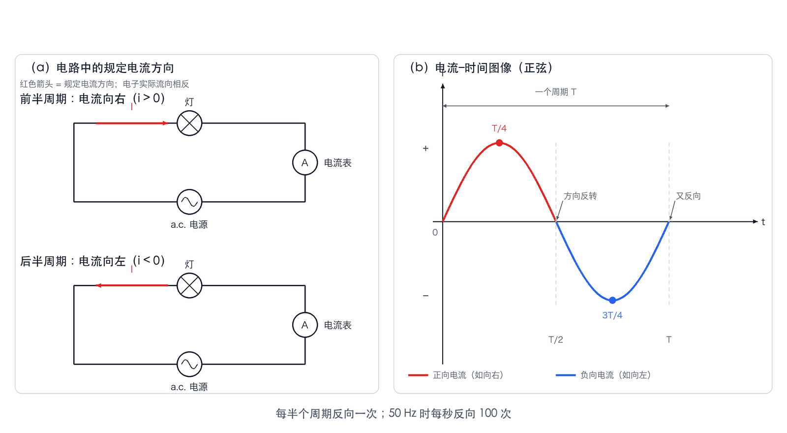
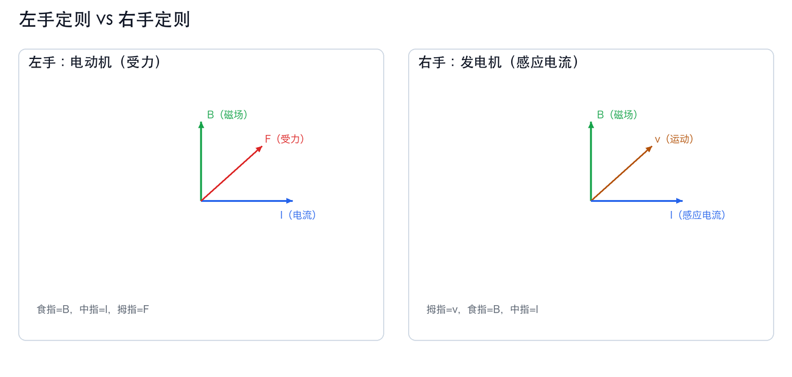
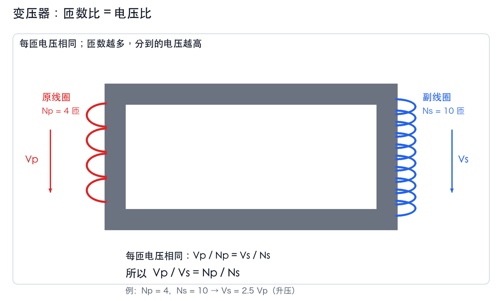

# IGCSE Physics 0625 – Topic 4: Electricity and Magnetism
- 这份笔记由 LG-leo 整理和维护。如果你觉得这份笔记对你有帮助，欢迎在 GitHub 上关注我或给我一个 ⭐，这能帮助我持续产出更多免费的学习资源。
- 我的其他课程笔记：https://github.com/LG-leo?tab=repositories
- This note is maintained by LG-leo. If you find it helpful, feel free to follow me or leave a ⭐ on GitHub. It helps me keep producing more free study resources. Check out my other notes: https://github.com/LG-leo?tab=repositories

## Important Notes

This document follows the **CAIE 0625 Syllabus for 2026, 2027 and 2028** (version 2, published December 2025) point by point, and adds exam keywords and common traps based on Paper 2 and Paper 4 questions.

Points to note compared with older resources:

- **Digital electronics / logic gates are not in the syllabus** (NOT, AND, OR, etc. have been removed).
- **Digital and analogue signals** now belong to **Topic 3, section 3.3 Supplement**, not Topic 4.
- Current structure: **4.4 is Electrical safety** and **4.5 is Electromagnetic effects**; older numbering such as "4.4 Digital electronics, 4.5 Dangers, 4.6 EM effects" is out of date.
- **4.5.2 The a.c. generator is Supplement only (Extended).**

Sources:

- [CAIE 0625 Syllabus 2026–2028 (official PDF)](https://www.cambridgeinternational.org/Images/697209-2026-2028-syllabus.pdf)
- [xtremepape.rs](https://papers.xtremepape.rs/) – past paper index
- [Save My Exams](https://www.savemyexams.com/igcse/physics/cie/23/) – topic-wise questions and answers
- [IITian Academy](https://www.iitianacademy.com/igcse-physics/) – topic-wise questions

---

## Part 1: Syllabus Structure

| No. | Content | Chinese | Tier |
|-----|---------|---------|------|
| 4.1 | Simple phenomena of magnetism | 简单磁现象 | Core + Supplement |
| 4.2 | Electrical quantities | 电学量 | — |
| 4.2.1 | Electric charge | 电荷 | Core + Supplement |
| 4.2.2 | Electric current | 电流 | Core + Supplement |
| 4.2.3 | Electromotive force and potential difference | 电动势与电势差 | Core + Supplement |
| 4.2.4 | Resistance | 电阻 | Core + Supplement |
| 4.2.5 | Electrical energy and electrical power | 电能与电功率 | Core |
| 4.3 | Electric circuits | 电路 | — |
| 4.3.1 | Circuit diagrams and circuit components | 电路图与元件 | Core + Supplement |
| 4.3.2 | Series and parallel circuits | 串联与并联 | Core + Supplement |
| 4.3.3 | Action and use of circuit components | 元件的作用 | Core + Supplement |
| 4.4 | Electrical safety | 用电安全 | Core |
| 4.5 | Electromagnetic effects | 电磁效应 | — |
| 4.5.1 | Electromagnetic induction | 电磁感应 | Core + Supplement |
| 4.5.2 | The a.c. generator | 交流发电机 | Supplement |
| 4.5.3 | Magnetic effect of a current | 电流的磁效应 | Core + Supplement |
| 4.5.4 | Force on a current-carrying conductor | 磁场对通电导体的力 | Core + Supplement |
| 4.5.5 | The d.c. motor | 直流电动机 | Core + Supplement |
| 4.5.6 | The transformer | 变压器 | Core + Supplement |

> Memory hook: **magnetism (4.1) → electrical quantities (4.2) → circuits (4.3) → safety (4.4) → electromagnetic effects (4.5)**.

---

## Part 2: Knowledge Points

### 4.1 Simple Phenomena of Magnetism

**Core**
- Magnetic poles: **north (N)** and **south (S)**; **like poles repel, unlike poles attract**.
- Magnets attract **magnetic materials** (iron, steel, nickel, cobalt); they do not attract non-magnetic materials such as copper, aluminium, plastic, glass and wood.
- **Induced magnetism**: a magnetic material placed near a magnet becomes magnetised; the end nearest the magnet acquires the **opposite polarity**.
- **Temporary vs permanent magnets**:
  - **Soft iron**: easily magnetised and easily demagnetised → used for **electromagnet cores**.
  - **Steel**: harder to magnetise but retains magnetism → used for **permanent magnets**.
- **Magnetic field**: a region in which a magnetic pole experiences a force.
- **Direction of a magnetic field** at a point: the direction of the force on the **N pole** placed at that point.
- **Field lines around a bar magnet**: outside the magnet they go from **N to S**; inside they go from S to N; field lines **never cross**.
- **Plotting**: iron filings show the pattern; a **plotting compass** shows the direction.
- **Uses**:
  - Permanent magnets: compasses, permanent magnets in loudspeakers, door catches, fridge magnets.
  - Electromagnets: cranes, relays, motors, generators, loudspeaker coils.

**Supplement**
- Magnetic forces are due to **interactions between magnetic fields**.
- The **spacing** of field lines represents the relative strength of the field: closer lines = stronger field.

**Common traps**
- Field lines are **imaginary** and never cross.
- Magnets attract magnetic materials, not all metals (copper and aluminium are not attracted).
- Soft iron is used for electromagnet cores, not permanent magnets; steel is used for permanent magnets.
- The induced pole nearest the magnet is **opposite** to the magnet's pole.

---

### 4.2 Electrical Quantities

#### 4.2.1 Electric Charge and Electric Fields (Core + Supplement)

**Core**
- Two types of charge: **positive** and **negative**.
- **Like charges repel, unlike charges attract**.
- **Charging by friction**: rub insulators together, e.g. a plastic rod or balloon attracts small pieces of paper; an **electroscope** can detect the charge.
- **The mechanism**: only **negative charge (electrons)** is transferred; protons do not move.
  - Losing electrons → positive charge; gaining electrons → negative charge.
- **Conductors vs insulators experiment**: test whether charge can move through different materials.
- **Electron model**:
  - Conductors (copper, aluminium, graphite) have **free electrons** that can move;
  - Insulators (plastic, glass, dry wood) have electrons that are not free to move.

**Supplement**
- Charge is measured in **coulombs (C)**.
- **Electric field**: a region in which an electric charge experiences a force.
- **Direction of an electric field**: the direction of the force on a **positive charge**.
- **Field patterns**:
  - around a point charge: radial;
  - around a charged conducting sphere: radial outside, like a point charge;
  - between two oppositely charged parallel conducting plates: **uniform field**, from the positive plate to the negative plate.
- The syllabus states that **edge effects are not examined**.

**Common traps**
- Friction transfers **electrons**, not protons.
- Electric field direction is defined by the force on a **positive** charge.
- An uncharged light object can be attracted by a charged object because of induced polarisation; attraction alone does not prove it has the opposite charge.

#### 4.2.2 Electric Current (Core + Supplement)

**Core**
- Electric current is related to the **flow of charge**.
- **Ammeter**: connected **in series**; analogue and digital ammeters have different ranges.
- **Conduction in metals**: due to the movement of **free electrons**.
- **Direct current (d.c.)**: current flows in one direction; **alternating current (a.c.)**: current repeatedly reverses direction.

> Figure: the current reverses direction every half cycle; red and blue show the two opposite directions.

**Supplement**
- `I = Q / t`, unit ampere (A), 1 A = 1 C/s.
- **Conventional current**: from the **positive** terminal of the supply, through the external circuit, to the **negative** terminal.
- **Free electrons** actually flow in the **opposite** direction (from negative to positive).

**Extension (beyond the syllabus – for understanding only)**
- **Electrons drift very slowly**: in a copper wire carrying about 1 A, the drift velocity is only of the order of **mm/s or even smaller**; the random thermal speed of electrons is about **10⁶ m/s**, but this does not produce a current.
- **In a.c. the electrons just oscillate**: at 50 Hz the displacement amplitude is only about a **micrometre**, and the net displacement over a cycle is almost zero; the current reverses, but electrons do not travel from the power station to your home.
- **Why a lamp lights instantly**: the electric field/electromagnetic field is established at nearly the speed of light and carries the energy, not the moving electrons themselves.
- ⚠️ 0625 does not require the numerical values of drift velocity or amplitude; these are for understanding only – do not write them in exam answers.

**Common traps**
- Conventional current and electron flow are in opposite directions.
- An ammeter must be in series; connecting it in parallel can short-circuit the supply.
- Current is the **rate of flow of charge**, not the amount of charge.

#### 4.2.3 Electromotive Force and Potential Difference (Core + Supplement)

**Core**
- **e.m.f.**: the electrical work done by a source in moving **unit charge** around a **complete circuit**; measured in **volts (V)**.
- **p.d.**: the work done by **unit charge** as it passes through a **component**; measured in **volts (V)**.
- **Voltmeter**: connected **in parallel** across the component or supply; analogue and digital voltmeters have different ranges.

**Supplement**
- `E = W / Q` (e.m.f.)
- `V = W / Q` (p.d.)

**Common traps**
- Both are "work per unit charge" in volts, but e.m.f. refers to the **source/complete circuit** and p.d. refers to a **component**.
- A voltmeter is connected in parallel, never in series.

#### 4.2.4 Resistance (Core + Supplement)

**Core**
- `R = V / I`, unit **ohm (Ω)**.
- **Experiment to determine resistance**:
  - ammeter in series with the resistor; voltmeter in parallel across it;
  - use a variable resistor to obtain several pairs of V and I;
  - calculate `R = V / I` for each pair.
- **Qualitative relationship for a metallic wire**:
  - the longer the wire, the greater the resistance;
  - the greater the cross-sectional area, the smaller the resistance.

**Supplement**
- **I–V graphs**:
  - **fixed resistor**: a straight line through the origin (constant resistance);
  - **filament lamp**: a curve; as current and temperature increase, resistance increases and the curve flattens;
  - **diode**: negligible current in reverse; in forward direction it conducts only after a certain voltage.
- Quantitative relationships: `R ∝ L` and `R ∝ 1/A`.

**Common traps**
- `R = V/I` is the **definition** of resistance, but filament lamps and diodes are **non-ohmic**; their I–V graphs are not straight lines.
- For a metal, resistance **increases** with temperature.
- Do not swap the ammeter and voltmeter connections.

#### 4.2.5 Electrical Energy and Electrical Power (Core)

- Circuits transfer energy from a source (cell or mains supply) to components and then to the surroundings.
- Power: `P = I V`, unit **watt (W)**.
- Energy: `E = I V t`, unit **joule (J)**.
- **Kilowatt-hour (kWh)**: a practical unit of energy; `1 kWh = 3.6 × 10⁶ J`.
- Cost: `cost = energy used in kWh × price per kWh`.

**Common traps**
- For kWh calculations use power in **kW** and time in **hours**; for joules use W and s.
- 1 kWh is 3.6 × 10⁶ J, not 1 J.
- In `P = IV`, V is the p.d. **across that component**.

---

### 4.3 Electric Circuits

#### 4.3.1 Circuit Diagrams and Circuit Components (Core + Supplement)

**Core: recognise the symbols and know how the components behave**
| Component | Behaviour |
|---|---|
| cell / battery / power supply / generator | source of e.m.f. |
| switch | opens or closes the circuit |
| fixed resistor | fixed resistance |
| variable resistor | resistance can be varied |
| potential divider | two resistors in series; tapped output voltage |
| heater | electrical energy → internal energy |
| thermistor (NTC only) | resistance **decreases** as temperature increases |
| LDR (light-dependent resistor) | resistance **decreases** as light intensity increases |
| lamp | electrical energy → light/heat; filament is non-ohmic |
| motor | electrical energy → kinetic energy |
| bell | electrical energy → sound |
| ammeter | measures current; connected **in series** |
| voltmeter | measures p.d.; connected **in parallel** |
| magnetising coil | produces a magnetic field when current flows |
| transformer | changes an alternating voltage |
| fuse | melts when current is too large |
| relay | electromagnetic switch |

**Supplement**
- **Diode**: allows current in one direction only.
- **LED**: a diode that emits light when conducting.

**For understanding only — not examined: why an LDR's resistance falls in light**
- An LDR is a semiconductor device (e.g. cadmium sulfide). In darkness there are few free charge carriers, so the resistance is high. When light falls on it, photons give energy to bound electrons, exciting them into the conduction band; this increases the number of charge carriers, so the resistance decreases.
- Typical orders of magnitude: several MΩ in the dark, a few hundred Ω in bright light (orders of magnitude only — do not memorise values).
- Common use: an LDR in a potential divider converts a change in light intensity into a change in voltage (street lights, light-operated switches, burglar alarms). If the output is taken across the LDR: dim light → high LDR resistance → larger share of the p.d.; bright light → smaller share.
- The syllabus only requires: **resistance decreases as light intensity increases**; the mechanism and values above are not examined.

**Common traps**
- Thermistor is **NTC**: temperature ↑ → resistance ↓; LDR: light ↑ → resistance ↓.
- A diode conducts in one direction only.
- A relay is an **electromagnetic switch**, not an ordinary switch.

#### 4.3.2 Series and Parallel Circuits (Core + Supplement)

**Core**
- In a series circuit the **current is the same at every point**.
- Construct and use series and parallel circuits.
- Sources in series: the combined e.m.f. is the sum of the individual e.m.f.s.
- Resistors in series: `R = R₁ + R₂ + …`
- In a parallel circuit, the **current from the source is larger than the current in each branch**.
- The combined resistance of two resistors in parallel is **less than the resistance of either resistor**.
- **Advantages of connecting lamps in parallel**: each lamp receives the full supply p.d.; if one lamp fails, the others continue to work; lamps can be switched independently.

**Supplement**
- At a junction, the **sum of currents entering = sum of currents leaving**.
- In series, the **total p.d. = sum of the individual p.d.s**.
- In parallel, the **p.d. across each branch is the same**.
- For two resistors in parallel: `1/R = 1/R₁ + 1/R₂`.

**Common traps**
- Series: current is the same, p.d. is shared. Parallel: p.d. is the same, current is shared.
- The combined resistance in parallel is **smaller** than either resistor, not the sum.
- The source current in a parallel circuit is larger than any single branch current, while the branch p.d.s are equal.

#### 4.3.3 Action and Use of Circuit Components (Core + Supplement)

**Core**
- For a constant current, the p.d. across a conductor increases as its resistance increases (`V = IR`).

**Supplement**
- **Variable potential divider**: a variable resistor connected as a three-terminal device provides an adjustable output p.d.
- **Potential divider equation**: `R₁ / R₂ = V₁ / V₂`.

**Common traps**
- The voltage ratio follows the **resistance ratio**, not simply the length ratio (unless the resistance wire is uniform).
- The output of a potential divider changes when a load is connected across it.

---

### 4.4 Electrical Safety (Core)

- **Hazards**:
  - damaged insulation;
  - overheating cables;
  - damp conditions;
  - excess current from overloading plugs, extension leads, single and multiple sockets on a mains supply.
- **Mains circuit**:
  - **live (line)** wire: at a high potential;
  - **neutral** wire: near earth potential;
  - **earth** wire: safety connection.
- A **switch must be connected to the live wire** so that the appliance is isolated when switched off.
- **Fuse**: melts when the current is too large; its rating should be **slightly greater** than the normal operating current.
- **Trip switch**: switches off the circuit when there is excess current or a fault; it can be reset.
- **Casing safety**:
  - a metal casing must be **earthed**;
  - or the appliance is **double-insulated**, with an insulating casing, so no earth connection is needed.
- A fuse without an earth wire still protects the circuit and cabling of a double-insulated appliance.

**Common traps**
- Both the switch and the fuse are connected to the **live** wire, not the neutral.
- The earth wire carries current only in a fault; it is not a normal current path.
- Never replace a fuse with copper wire or foil.
- Damp conditions lower the resistance of the human body, increasing the danger.

---

### 4.5 Electromagnetic Effects

#### 4.5.1 Electromagnetic Induction (Core + Supplement)

**Core**
- An e.m.f. is induced in a conductor when it **moves across a magnetic field** (cuts field lines) or when the **magnetic field linking it changes**.
- Experiment: moving a magnet into or out of a coil causes a galvanometer to deflect.
- **Factors affecting the magnitude of the induced e.m.f.**: speed of movement, strength of the magnetic field, number of turns on the coil.

**Supplement**
- **Lenz's law**: the direction of the induced e.m.f./current **opposes the change** that causes it.
- **Fleming's right-hand rule** (generator): thumb = motion/force, first finger = field, second finger = induced current.

**Common traps**
- No induced e.m.f. if the field is not changing and the conductor is not cutting field lines.
- The direction of the induced current is found from "opposing the change", not arbitrarily.
- Right-hand rule is for **generators/induced current**; do not confuse it with the left-hand rule for motors.

#### 4.5.2 The a.c. Generator (Supplement)

- A simple a.c. generator: a **rotating coil** (or rotating magnet) with **slip rings** and **brushes**.
- The coil rotates at constant speed → the induced e.m.f. changes in magnitude and direction periodically → **alternating current**.
- **e.m.f.–time graph** is sinusoidal:
  - when the **plane of the coil is parallel** to the field, the sides cut field lines at the greatest rate → e.m.f. is **maximum**;
  - when the **plane of the coil is perpendicular** to the field, the flux is maximum but its rate of change is zero → e.m.f. is **zero**.

**Common traps**
- Generators use **slip rings**; d.c. motors use a **split-ring commutator**.
- When the e.m.f. is zero, the flux is maximum, not zero.

#### 4.5.3 Magnetic Effect of a Current (Core + Supplement)

**Core**
- **Straight wire**: the field lines are **concentric circles**; direction given by the **right-hand grip rule** (thumb = current, fingers = field).
- **Solenoid**: the field outside is like that of a bar magnet; inside it is strong and fairly uniform; polarity found with the right-hand grip rule (fingers = current, thumb = N pole).
- Experiments: iron filings and plotting compasses to show the pattern and direction.
- **Uses**: **relays** and **loudspeakers**.
  - Relay: an electromagnet attracts an armature to make or break another circuit.
  - Loudspeaker: the current-carrying coil experiences a force in the permanent magnet's field, making the cone vibrate.

**Supplement**
- The field is stronger closer to the wire; it is increased by a larger current, more turns and a soft-iron core.
- Reversing the current reverses the field direction.

**Common traps**
- The field around a straight wire is circular, not a set of lines from N to S.
- Inside a solenoid the field direction is opposite to the external field (closed loops).
- A loudspeaker uses the **force on a current-carrying conductor** (motor effect).

#### 4.5.4 Force on a Current-Carrying Conductor (Core + Supplement)

**Core**
- A current-carrying conductor in a magnetic field experiences a **force** (motor effect).
- Experiment: a wire between magnet poles moves when current flows; reversing either the current or the field reverses the force.

**Supplement**
- **Fleming's left-hand rule**: first finger = field, second finger = current, thumb = force.
- For a beam of **charged particles** in a magnetic field, use the left-hand rule with the conventional current direction; a negative charge experiences a force in the opposite direction.

**Common traps**
- Left-hand rule → motor/force; right-hand rule → generator/induced current.
- Reversing one of current/field reverses the force; reversing both leaves the force direction unchanged.

#### 4.5.5 The d.c. Motor (Core + Supplement)

**Core**
- A current-carrying coil in a magnetic field may experience a **turning effect**.
- The turning effect is increased by: **more turns on the coil, a larger current, a stronger magnetic field**.

**Supplement**
- Construction: coil + magnets + **split-ring commutator** + brushes.
- The commutator reverses the current in the coil every half-turn, so the coil continues to rotate in the same direction.

**Common traps**
- The commutator reverses the **current in the coil**, not the magnetic field.
- Without a commutator, the coil would oscillate about its equilibrium position.

#### 4.5.6 The Transformer (Core + Supplement)

**Core**
- Construction: **soft-iron core** + primary coil + secondary coil.
- Terms: **step-up** (`N_s > N_p`) and **step-down** (`N_s < N_p`).
- `V_p / V_s = N_p / N_s`.
- Used in **high-voltage transmission** of electricity.
- **Advantage of high-voltage transmission**: for the same power, a higher voltage means a smaller current, so less energy is wasted as heat in the cables.

**Supplement**
- Principle: an alternating current in the primary produces a changing magnetic flux in the core, which induces an e.m.f. in the secondary.
- Ideal transformer (100% efficiency): `I_p V_p = I_s V_s`.
- Power loss: `P = I²R`, so a higher transmission voltage (smaller current) gives smaller cable losses.

**Common traps**
- A transformer **does not work with d.c.** (no changing flux).
- Step-up increases voltage but decreases current (ideal power is constant).
- The core is **soft iron**, not steel; soft iron is easily magnetised and demagnetised.
- A transformer does not change the frequency.

---

## Part 2.5: Intuitive Understanding (for memory, not examined)

- **Current = water flow**: I is "how much charge flows per second"; voltage is like "water pressure"; resistance is like "pipe width and length".
- **Conventional current vs electrons**: conventional current is the "positive-charge direction"; in a metal the electrons move the opposite way. Both describe the same current.
- **e.m.f. vs p.d.**: e.m.f. is "the pump giving energy per coulomb"; p.d. is "the turbine taking energy per coulomb". Both are measured in volts.
- **Series vs parallel**: series is "one road" – the current is the same everywhere; parallel is "many roads" – the p.d. is the same and the total resistance is smaller.
- **Resistance**: a longer wire is harder to push current through; a thicker wire is easier. A hot filament has a higher resistance.
- **I–V graphs**: a fixed resistor is a straight line; a filament lamp is a curve (hotter → harder to push current); a diode is a "one-way street".
- **Power and energy**: `P = IV` is "energy used per second"; `E = IVt` is "total energy used"; kWh is the unit used on electricity bills.
- **Safety**: a fuse is a "safety valve" that melts first when the current is too large; the earth wire is an "escape route" for fault current; switches and fuses go on the live wire.
- **Electromagnetic induction**: moving a magnet in or out of a coil makes the galvanometer deflect; you need cutting of field lines or a changing flux.
- **Left/right-hand rules**: left hand = motor (force); right hand = generator (induced current).
- **Transformers**: each turn has the same voltage, so the turns ratio equals the voltage ratio; step-up increases voltage and decreases current; high-voltage transmission reduces `I²R` losses.

> Figure: Fleming's left-hand rule is used for the force on a motor; the right-hand rule is used for the induced current in a generator.

> Figure: each turn has the same voltage, so more turns give a larger share of the voltage; e.g. Np = 4, Ns = 10 → Vs = 2.5Vp. `Vp/Vs = Np/Ns`.

## Part 3: Equations and Constants

| Quantity | Equation | Unit | Tier/notes |
|---|---|---|---|
| Electric current | `I = Q / t` | A, C, s | Supplement |
| e.m.f. | `E = W / Q` | V, J, C | Supplement |
| p.d. | `V = W / Q` | V, J, C | Supplement |
| Resistance | `R = V / I` | Ω, V, A | Core |
| Electrical power | `P = I V` | W, A, V | Core |
| Electrical energy | `E = I V t` | J, A, V, s | Core |
| Kilowatt-hour | `1 kWh = 3.6 × 10⁶ J` | kWh, J | Core |
| Resistors in series | `R = R₁ + R₂ + …` | Ω | Core |
| Two resistors in parallel | `1/R = 1/R₁ + 1/R₂` | Ω | Supplement |
| Potential divider | `R₁ / R₂ = V₁ / V₂` | — | Supplement |
| Transformer voltage ratio | `V_p / V_s = N_p / N_s` | V, turns | Core |
| Ideal transformer | `I_p V_p = I_s V_s` | A, V | Supplement |
| Cable power loss | `P = I² R` | W, A, Ω | Supplement |

---

## Part 4: Common Traps

| Wrong statement | Correct understanding |
|---|---|
| Protons are transferred during friction | Only **electrons** are transferred |
| Current direction is the electron flow | Conventional current is + → −; electrons flow − → + |
| Electrons travel from the power station at nearly light speed | Electrons drift at only mm/s; the energy is carried by the electromagnetic field |
| Ammeter in parallel, voltmeter in series | Ammeter in series, voltmeter in parallel |
| e.m.f. and p.d. are identical | Both are W/Q, but e.m.f. is for the source/circuit and p.d. for a component |
| Filament lamps and diodes obey I ∝ V | They are non-ohmic; their I–V graphs are not straight lines |
| Voltage is the same across series components | Current is the same; p.d. is shared |
| Parallel resistance is larger than each branch | It is **smaller** than either resistor |
| Thermistor resistance increases with temperature | NTC: temperature ↑ → resistance ↓ |
| LDR resistance increases in bright light | Bright light → resistance ↓ |
| Fuse/switch on the neutral wire | They must be on the **live** wire |
| The earth wire carries current normally | It is a safety wire; it carries current only in a fault |
| Transformers work with d.c. | They work only with a.c. |
| Step-up increases both voltage and current | Voltage ↑, current ↓ (ideal) |
| Generators use a commutator | Generators use **slip rings**; motors use a commutator |
| Left-hand rule gives induced current | Left-hand rule is for force; induced current uses the **right-hand rule** |
| A steady magnetic field induces an e.m.f. | The conductor must cut field lines or the flux must change |

---

## Part 5: Paper 4 Answer Templates

- **Magnetisation**: Soft iron is easily magnetised and demagnetised, so it is used for electromagnet cores; steel retains its magnetism, so it is used for permanent magnets.
- **Charging by friction**: When two insulators are rubbed together, electrons are transferred from one to the other. The material that loses electrons becomes positively charged; the one that gains electrons becomes negatively charged.
- **Electric field direction**: The direction of an electric field at a point is the direction of the force on a positive charge placed at that point.
- **e.m.f. and p.d.**: The e.m.f. is the work done by the source per unit charge in moving charge around a complete circuit. The p.d. is the work done per unit charge as charge passes through a component.
- **Resistance experiment**: Connect the ammeter in series and the voltmeter in parallel across the resistor. Vary the current with a variable resistor, record pairs of V and I, then calculate R = V/I.
- **Filament I–V graph**: As the current increases, the filament temperature rises, so its resistance increases; therefore the I–V graph curves and is not a straight line.
- **Series and parallel**: In a series circuit the current is the same at every point and the total p.d. is the sum of the individual p.d.s. In a parallel circuit the p.d. across each branch is the same and the total current is the sum of the branch currents.
- **Parallel resistance**: The combined resistance of two resistors in parallel is less than the resistance of either resistor because there are more paths for the current.
- **Potential divider**: The p.d. across each resistor is proportional to its resistance, so `R₁/R₂ = V₁/V₂`.
- **Fuse and switch**: The fuse and the switch must be connected to the live wire so that the appliance is isolated from the high potential when switched off or when the fuse melts.
- **Electromagnetic induction**: An e.m.f. is induced when a conductor cuts magnetic field lines or when the magnetic field linked with a conductor changes; the induced e.m.f. opposes the change causing it.
- **Transformer**: An alternating current in the primary coil produces a changing magnetic flux in the soft-iron core, which induces an e.m.f. in the secondary coil. `V_p/V_s = N_p/N_s`; for an ideal transformer, `I_pV_p = I_sV_s`.
- **High-voltage transmission**: For the same power, a higher transmission voltage means a smaller current, so the heating loss in the cables (`P = I²R`) is smaller.

---

## Part 6: Keyword Glossary

| Keyword | Definition |
|---|---|
| **Magnetic pole** | region of a magnet where the magnetic force is strongest (N or S) |
| **Induced magnetism** | magnetisation of a magnetic material placed near a magnet |
| **Temporary magnet** | soft iron; easily magnetised and demagnetised |
| **Permanent magnet** | steel; retains its magnetism |
| **Magnetic field** | region in which a magnetic pole experiences a force |
| **Magnetic field line** | imaginary line showing the direction and strength of a magnetic field |
| **Electric charge** | positive or negative charge; measured in coulombs (C) |
| **Electric field** | region in which an electric charge experiences a force |
| **Electric current** | rate of flow of charge, `I = Q/t` |
| **Conventional current** | direction from positive to negative |
| **e.m.f.** | work done by a source per unit charge around a complete circuit |
| **p.d.** | work done per unit charge through a component |
| **Resistance** | `R = V/I`; unit ohm (Ω) |
| **Ohmic conductor** | conductor whose I–V graph is a straight line through the origin |
| **Series circuit** | single path; current is the same everywhere |
| **Parallel circuit** | branches; p.d. is the same across each branch |
| **Potential divider** | arrangement of resistors to obtain a fraction of the supply p.d. |
| **Thermistor** | NTC resistor: resistance decreases as temperature increases |
| **LDR** | light-dependent resistor: resistance decreases as light intensity increases |
| **Diode** | component that allows current in one direction only |
| **LED** | diode that emits light when conducting |
| **Relay** | switch operated by an electromagnet |
| **Live / neutral / earth** | the three wires of a mains circuit; earth is for safety |
| **Fuse** | safety device that melts when the current is too large |
| **Double insulation** | insulating casing; no earth connection needed |
| **Electromagnetic induction** | induced e.m.f. when a conductor cuts field lines or flux changes |
| **Lenz's law** | induced current opposes the change causing it |
| **a.c. generator** | generator using slip rings to produce alternating current |
| **d.c. motor** | motor using a split-ring commutator to keep rotating |
| **Transformer** | changes an alternating voltage; `V_p/V_s = N_p/N_s` |

---

## Part 7: Final Self-check

1. Can you explain pole forces, induced magnetism, and the difference between soft iron and steel?
2. Do you know the direction of field lines, what their spacing means, and how to plot them?
3. Can you explain charging by friction (electron transfer) and the electron model of conductors/insulators?
4. Can you describe electric field direction and the three field patterns?
5. Do you know conventional current vs electron flow and the correct meter connections?
6. Can you define e.m.f. and p.d. and use `E = W/Q` and `V = W/Q`?
7. Can you use `R = V/I`, describe the resistance experiment, and sketch I–V graphs for a resistor, filament lamp and diode?
8. Do you know the series/parallel rules and how to calculate a parallel resistance?
9. Can you use the potential divider equation `R₁/R₂ = V₁/V₂`?
10. Can you explain live/neutral/earth, switch/fuse positions, double insulation and earthing?
11. Can you explain electromagnetic induction, Lenz's law and when to use each hand rule?
12. Do you know the a.c. generator vs d.c. motor structures, transformer equations and high-voltage transmission?
